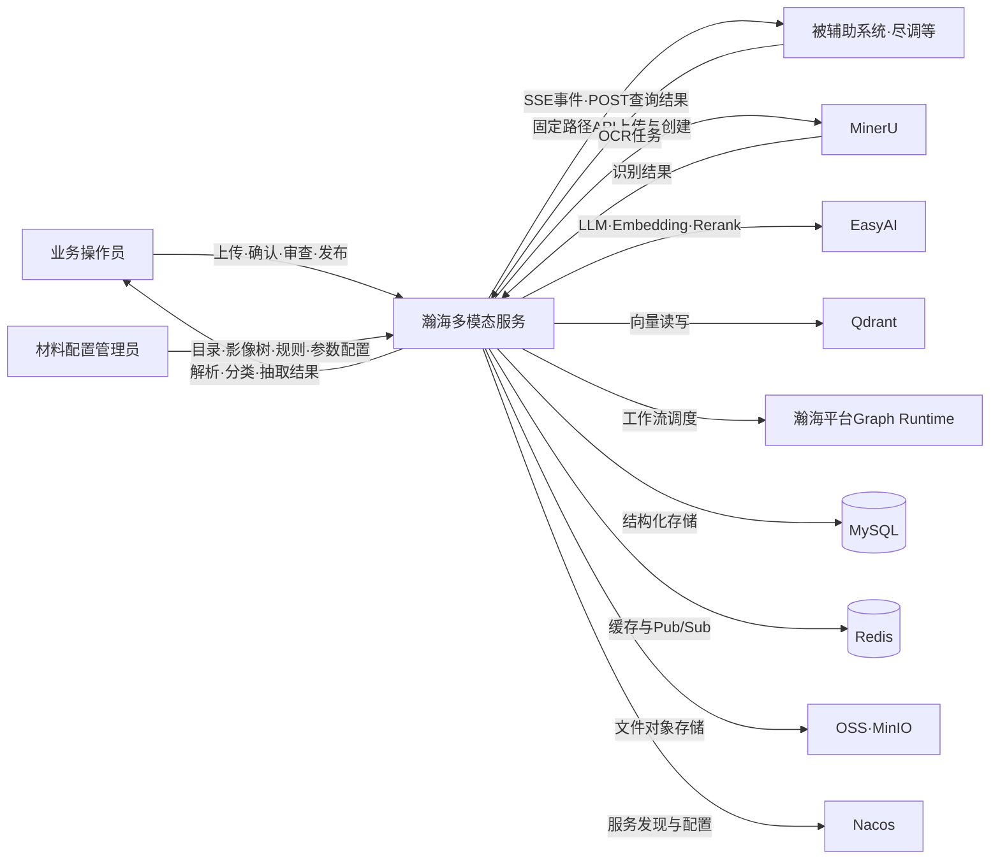
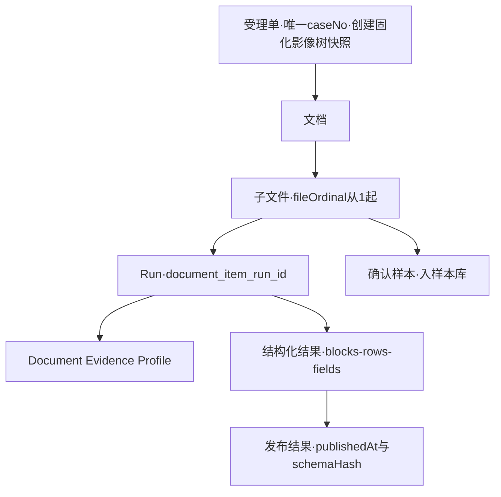

# 瀚海多模态服务需求文档

## 1 文档信息

| 项 | 内容 |
|---|---|
| 版本标识 | draft-v1（草稿，未定稿，不打版本号） |
| 日期 | 2026-10-15 |
| 状态 | 草稿——含【AI 推测】标注与文末问题清单，待消歧与终裁 |
| 范围 | 覆盖瀚海多模态服务的十一个功能域：受理单与影像树、文档接入与解析、材料分类、结构化抽取与结果交付、特征提取与媒体数据、影像合规审查、对外 API、智能分类助手与分类优化 Agent、规则管理、配置管理、实时通知。写用户可见行为、可判定约束与异常语义；不写内部模块设计、数据库结构、部署与运维细节 |
| 读者对象【AI 推测】 | 用户方业务与产品人员（读背景、场景、各域故事）、开发（读行为约束与异常语义）、测试（读可判定约束） |

素材性质与标注约定：

- 本稿素材为混合素材：各域需求文档（最新至 2026-10-08）与 dev 分支代码现状（至 2026-09-29）。各功能域章标题后括注实现状态——已实现 / 部分实现 / 待实现；部分实现域内区分「当前实现」与「目标态（未实现）」。
- 素材自带裁决原则「文档与代码不一致时以代码行为为准」仅是素材内部口径，不算终裁；已知的需求-实现冲突已逐条列入文末问题清单送人裁决（Q1–Q7），本文按代码现状口径书写，终裁前该口径不视为定论。
- 文中【AI 推测】表示该内容素材未直接支持、由整理者归纳补充，须随问题清单送裁。

## 2 背景与目标

### 2.1 背景与痛点

尽调等被辅助系统在处理信贷类业务材料时，面对的是多来源、多形态的异构输入：PDF 与图片扫描件、Office 文档、压缩包批次、音视频。这些材料过去依赖人工逐份查看、人工归类、人工抄录关键数据，耗时且口径不一；下游系统拿到的是缺乏统一结构、无法追溯证据来源的结果，数据核对与审计成本高【AI 推测】——素材未直接陈述业务痛点，此段由系统定位反推，见问题清单 Q10。

瀚海多模态服务承接这批材料后自动完成解析识别、分类、特征提取与结构化抽取，经人工确认后发布结构化结果，并向被辅助系统交付。整个链条上，机器负责识别与计算，人负责确认与裁决。

### 2.2 成功标准（可判定底线）【AI 推测】

素材未给出量化指标，以下底线标准由素材全局业务原则改写，逐条可构造观察情形验证，送裁见问题清单 Q10：

1. 全链路无静默降级：任一配置缺失、模型不匹配、关键外部依赖不可用时，系统显式失败或显式记录降级原因；不存在静默换模型、换路径、补隐藏默认值的路径。
2. 历史零污染：每次处理生成新 Run（document_item_run_id），重处理、重新抽取不覆盖任何历史记录。
3. 发布可信：所有对外发布的结构化结果 100% 经过人工复核，携带 publishedAt 与运行绑定的 schemaHash，发布后固化不可再改；发布前校验（字段校验、数据勾稽、就绪检查）失败时发布被阻止并给出缺失/阻断项清单。
4. 交付不丢不重：外部系统经 SSE 收到的事件按 eventId 幂等消费，查询走固定路径 POST 接口，任一已发布结果可按 businessRef + materialCode 稳定取回。

### 2.3 明确不做什么

- 不产出业务结论：特征提取只记录事实、值、置信度与证据，不产生通过/不通过、风险等级等结论；智能验证规则属后续迭代。
- 不代下游加工报文：尽调侧自行将 response-schema 预展平成 CellMapper 报文，本服务不生成、不保存 tables/unpublished 报文。
- 不暴露内部标识：对外不接受 process_id / node_code / 影像树节点 ID / 材料主键作为入参，响应中禁止出现 caseId / documentItemId / runId 等内部主键与内部存储地址。
- 不保留旧能力：材料核验（material_verification）整体移除；旧外部动态路径、business-task-list 列表与 /batches/{id} 页面退役（上述口径均在问题清单送裁，见 Q1–Q3）。
- 分类助手增强（竞争证据分析、联动优化、Pi 服务端 Loop 试点、分类执行性能优化项）属待实现规划，不在本期交付范围。

## 3 用户与场景

### 3.1 用户类清单

素材未直接给出用户类划分，下表由页面与功能归属归纳【AI 推测】，送裁见问题清单 Q8：

| 用户类 | 特征 | 使用频率 | 能干什么 |
|---|---|---|---|
| 业务操作员 | 一线受理与复核人员，熟悉业务材料口径 | 每天高频 | 上传文档、查看解析与分类结果、确认影像分类、复核并修正抽取结果、识别修复、影像审查、确认结果、整单提交 |
| 材料配置管理员 | 管理材料目录、影像树、规则与系统参数的配置角色 | 低频，按配置变更 | 维护材料目录与智能分类配置、结果定义、样本库、影像树与业务阶段、审查要点、校验规则、通用识别配置 |
| 分类优化用户 | 负责分类质量调优的分析角色 | 中低频 | 创建分类优化任务、查看 Agent 运行与草案验证、确认发布分类变更 |
| 外部被辅助系统 | 经对外 API 对接的机器调用方（尽调等），非页面用户 | 系统级持续调用 | 上传/引用文件、创建与追加受理单、订阅 SSE、POST 查询进度与各域结果、按分类取数 |

本章场景由素材页面地图与各域功能点重组为端到端叙事，交互顺序与个别衔接细节未经用户确认【AI 推测】，送裁见问题清单 Q12。

### 3.2 场景一：业务操作员受理并办结一份受理单

角色：业务操作员。触发：收到一笔业务的全套影像材料需要录入系统。

操作员从受理单受理对话框创建受理单，系统按所选影像树固化结构快照并分配唯一 caseNo。操作员进入受理单工作台 /cases/{caseId}，在左侧「文档列表/影像树」双视图间切换（切换时保持同一当前影像），逐份上传文档：PDF/图片走 OCR 链路，DOCX/XLSX/PPTX 走 Office 原生解析，压缩包展开为子文件逐一派发，音视频走独立媒体解析路由。系统在「解析识别」阶段呈现各文档解析进度；操作员在「影像分类」阶段处理自动分类结果——达到自动确认线的子文件已标 AUTO_CONFIRMED，进入人工复核的逐个执行「确认影像分类」；接着在「数据提取」阶段查看结构化抽取与字段校验结果；在「影像审查」阶段查看校验场景结果；最后在「结果确认」阶段执行「确认结果」，随后整单提交。

结果：全部分类与结果确认完成，整单提交成功，结果固化并具备 publishedAt 与 schemaHash。

异常分支：任一文档解析失败（OCR 提交失败、Office 内容未持久化），失败状态与原因在文档审阅页可见，操作员可转场景二做识别修复；必需影像未传齐时，受理单详情页展示缺失影像清单，已传影像仍可审查，但整单提交被系统拦截并返回缺失影像清单，补齐后才能重新提交。

### 3.3 场景二：业务操作员在审阅工作台修复识别结果并复核

角色：业务操作员（或承担复核分工的同组人员）。触发：某文档 OCR 识别有误或抽取字段需要人工修正。

操作员在影像中心 /library 通过文件名、受理单号、业务编号或影像树名称检索定位到目标，进入文档审阅工作台 /documents/:id。页面上可切换子文档、预览原文并高亮证据；若识别文本有误，用识别修复（OcrRepairEditor）人工修正 OCR 结果；在抽取结果页签核对字段，对需要修正的字段直接编辑；抽取依据（页码、坐标、原文）可回溯核对；确认无误后执行发布动作，结果经人工复核固化。

结果：修正后的识别与抽取结果固化发布。

异常分支：若 Profile 未 READY（部分证据写失败），该文档分类显式失败并持久化原因，操作员在页面看到失败原因而非无限等待；结构化抽取失败时，系统显式给出失败记录（任务/定义/块/来源/目标名/原因），不会以全文回退或默认选首项的方式产出半成品。

### 3.4 场景三：材料配置管理员上线一个新材料的抽取配置

角色：材料配置管理员。触发：业务新增一种材料类型，需要可被自动分类并结构化抽取。

管理员进入材料配置中心 /material-config，在目录树中新增材料并配置智能分类（语义判断、关键识别词、别名、负向证据），可先用案例验证、再参考效果统计调参；配置结果定义（结果块、结果字段、单位、就绪检查与执行阻断项）；需要时在影像树配置 /image-tree-config 中把该材料挂到影像节点并设置是否必需、是否参与齐全性校验，绑定审查要点与业务阶段；在样本库中管理确认样本状态。配置完成后通过 JSON 导出/导入在环境间迁移（导入触发全量向量重建）。

结果：新材料进入已启用材料目录，受理单内文档的分类候选开始包含该材料，抽取链路按新结果定义执行。

异常分支：只配了一半的结果定义（如 TABLE 来源缺目标名称）在保存时未必报错，但执行时被显式阻断并给出阻断项清单——系统不补默认值、不跑半成品；配置修改不主动重算存量受理单，存量单在重新校验/提交/续跑时才按最新配置执行。

### 3.5 场景四：分类优化用户发起一次分类优化任务

角色：分类优化用户。触发：发现某类材料分类经常落到错误分类，需要调优。

用户进入智能分类助手 /classification-assistant，创建页只有「新增分类 / 优化分类」两类任务可选；创建「优化分类」任务时选定目标分类（必填），系统在创建时冻结案例样本与文档运行版本、当前执行与人工确认结果、配置基线、用户问题与期望、算法/模型/策略版本、轮次与成本预算。任务运行时，工作台三栏呈现：左侧运行上下文、中部 Agent 运行信息、右侧草案产物（窄屏按此序堆叠）；进度由 SSE 事件驱动刷新，无固定轮询。每产生一个新 Draft，系统自动执行两项必验——当前案例路径 A 真实试算与分类回归；用户在右侧查看 Draft、Evidence 与 Validation 结果，等待最新 Draft 两项必验全部 PASSED 且输入无漂移，任务进入 READY_FOR_REVIEW 后人工确认发布。

结果：分类配置变更经确认后发布生效。

异常分支：验证失败不是任务失败——失败 Draft 连同结构化反馈（errorCode / suggestedFocus）进入下一轮，预算未耗尽自动继续；预算耗尽时任务结构化阻断并明示，不隐藏续跑入口；同一修订方向第一次无进展时系统拒绝原计划、强制改证据问题或修改方向，第二次连续重复直接结构化阻断；LLM 自报完成无效，只有系统强制验证通过才达 READY_FOR_REVIEW。

### 3.6 场景五：外部被辅助系统接入并取数

角色：外部被辅助系统（机器调用方）。触发：尽调流程需要把一批材料交给多模态服务处理并取回结构化结果。

外部系统先解决文件来源：或经平台上传取得 platformFileId，或调用 POST /external/files/upload（multipart，带 Idempotency-Key）取得 uploadId 与 expiresAt。随后调用 POST /external/cases/create 创建受理单（body 含 businessRef、request、documents[]；每个 document 只含 platformFileId 或 uploadId 之一；materialCode 可选作预分类提示；压缩包用 archiveEntries 逐条目给分类；必传 workMode）。创建后系统按 SSE 通道推送事件；外部系统订阅 /external/events/stream（GET，重连带 Last-Event-ID），收到 RESULT_AVAILABLE 事件（必带 resourcePath、resourceMethod、businessRef）后，按 eventId 幂等去重，再 POST 调用 cases/progress/query 查询进度，按 materialCode 调三个按分类取数接口取回提取结果、影像特征与影像审查结果。

结果：结构化结果按子文件粒度稳定返回，多命中全部返回且顺序固定（文档创建序 → 文档内子文件序）。

异常分支：命中 0 份子文件返回 200 + 空 items 数组（不是 404），与分类不存在（MATERIAL_NOT_FOUND）严格区分；集合返回单项化——某影像未完成或失败不影响其他影像返回，未就绪项带 withheldReason（AWAITING_FINAL_CONFIRMATION / RESULT_NOT_READY / RESULT_FAILED）；同键同内容的重复请求重放首次结果，同键不同内容返回 409 IDEMPOTENCY_CONFLICT。

## 4 系统总览

瀚海多模态服务是瀚海智能助理系统的多模态能力服务：接收文档（PDF、图片、DOCX/XLSX/PPTX、压缩包、音视频），完成解析识别、材料自动分类、特征提取、结构化抽取与数据影像校验，经人工确认后发布结构化结果，并通过对外 API 与 SSE 事件向被辅助系统交付。

一条文档的完整生命周期（主链路）：

```text
上传/受理 → 文件画像与预处理 → 解析（OCR 或 Office 原生或媒体解析）
→ 内容标准化与信息增强 → 材料自动分类（双路径）→ 人工确认（按需）
→ 特征提取 → 结果定义冻结与结果块定位 → 结构化抽取与字段校验
→ 数据关系校验 → 人工复核 → 发布 → 对外查询/SSE 通知交付
```

文档工作流共 28 个节点，按簇依次为输入准备、OCR 决策、内容治理、业务分类（business_classify，唯一人工交互节点）、特征提取（feature_config_resolve / feature_extract）、抽取准备、坐标与上下文、结果生产；另有 Office 原生解析、压缩包批次、完整重处理三条入口。

贯穿全部功能域的业务原则（各域章不再复述）：配置缺失、模型不匹配、关键依赖不可用时显式失败（fail fast），不允许静默换模型、换路径或补隐藏默认值；每次处理生成新 Run，历史结果不静默混入、不覆盖；运行期冻结配置快照与版本（策略/模型/Prompt/算法），运行中修改配置不影响已执行阶段；发布后结果固化不可再改；发布前校验失败阻止发布并给出缺失/阻断项清单；业务结论（如校验 NOT_PASSED、审查不通过）不是 HTTP 错误，接口仍返回 200，结论在响应体中。

系统边界与数据流向（上下文图）：



核心业务实体及关系：



外部依赖不可控时，允许业务继续处理的才算降级，且必须显式记录原因；依赖清单与挂断后果见第 17 章。

页面地图（总览级导航，各域细节在域章内展开）：

| 路由 | 页面 | 承载功能 |
|---|---|---|
| /upload | 上传工作台 | 单文件上传、查看最近 9 条文档、进文档库 |
| /library | 影像中心 | 受理单分页视图 / 上传记录二级视图切换、文件名/受理单号/业务编号/影像树名称检索 |
| /documents/:id | 文档审阅工作台 | 子文档切换、原文预览与证据高亮、抽取结果/特征/解析结果页签、字段编辑、识别修复、发布 |
| /cases/:id、/businessRef/:ref | 受理单工作台 | 五阶段推进、影像分类确认、结果确认、影像审查查看、整单提交 |
| /material-config | 材料配置中心 | 目录树管理、智能分类/材料校验/结果定义/样本库配置、配置导入导出 |
| /classification-assistant | 智能分类助手 | 分类优化任务创建、三栏工作台、草案与验证查看、确认发布 |
| /image-tree-config | 影像树配置 | 通用识别配置、影像树与节点受理要求、审查要点、业务阶段 |
| /rule-management | 规则管理 | 规则场景/规则集/字段关系规则配置、rule-designer 画布设计器 |

前端支持独立运行与瀚海 portal 嵌入两种挂载，嵌入视图下页面背景已统一适配。业务编号深链 /businessRef/:ref 定位到受理单后跳转 /cases/:id；查询无结果或失败时留在深链页内报错，不猜测、不回退旧页面。

## 5 受理单与影像树（已实现）

本章服务业务操作员的受理与办结场景（3.2）：受理单是全部业务动作的载体，影像树定义「这笔业务要哪些影像、怎么算齐」。

领域模型上，受理单 MultimodalCase 拥有唯一 caseNo，创建时固化影像树结构快照，其下挂文档、文档下挂子文件；无关联表、无树版本。影像节点配置「是否必需 + 是否参与齐全性校验」两个独立属性：免校验影像不阻断整单提交但需明示；缺失影像在详情页展示缺失清单，已传影像仍可审查，整单提交被拦截并返回缺失影像清单——部分上传后提交，系统必须拦截并给出清单内容，这是可构造验证的拦截行为。

受理单内业务按阶段推进。业务阶段是可配置项（编码/名称/说明/启用/默认执行阶段/是否允许续跑，编码唯一），阶段间无固定顺序；执行前系统校验前置条件（识别完成、数据提取完成），不满足即拦截。同一阶段重复执行覆盖原结果；续跑接口按 caseNo + 阶段编码调用。审查要点绑定影像节点或整树，且必须关联至少一个业务阶段，无阶段绑定的配置校验失败。

阶段配置不建版本快照：修改配置不主动重算存量受理单，存量单在重新校验、提交或续跑时按最新配置执行——改配置后重跑，新配置生效。

页面行为上，影像中心 /library 提供应受单分页视图与上传记录二级视图，多条件检索；受理单工作台左侧提供「文档列表/影像树」双视图切换且保持同一当前影像；页面上与确认相关的动作只有「确认影像分类」与「确认结果」两个。旧 business-task-list 列表与 /batches/{id} 页面已退役，再现即缺陷（该口径送裁见 Q3）。

## 6 文档接入与解析（已实现）

本章服务业务操作员与外部系统的材料进入场景（3.2、3.6）：一份文件无论从哪个渠道进来，都要被转成可分类、可抽取的标准化内容。

接入渠道有三个：前端上传页（单文件）、受理单受理对话框、对外 API（第 11 章）。解析路由按文件类型分发：

| 文件类型 | 解析路由 |
|---|---|
| PDF / 图片 | OCR 链路：探测模型 → 候选模型路由 → MinerU 提交 → 结果摄取 |
| DOCX / XLSX / PPTX | Office 原生解析（五节点），之后汇入与 OCR 相同的分类抽取尾段 |
| 压缩包 | 展开为子文件，逐一独立派发 |
| 音视频 | 独立媒体解析路由，不进 OCR 流程 |

Office 与非 Office 的分类处理统一：两者都建立 Document Evidence Profile（版本 extraction-{documentItemRunId}，全部证据 embedding 完成才 READY），共用同一分类执行服务。Office 文档不得再走内存余弦相似度旧路径，前台不得出现「Office 特殊算法」标识（该口径送裁见 Q7）。

异常语义（每条用户均可在页面看到明确去向）：

1. Profile 非 READY（部分 point 写失败）：该文档分类显式失败并持久化原因，不降级。
2. 压缩包子文件独立分类，不把压缩包整体分类静默套用到子文件。
3. 解析失败（OCR 提交失败、Office 内容未持久化）：进入显式失败状态，失败原因从审阅页可见。
4. OCR 结果有误：审阅页可人工修复（OcrRepairEditor）。

## 7 材料分类（已实现）

本章服务业务操作员的分类确认场景（3.2）：机器给候选，人做终审，确认后的样本反哺匹配。

分类走双路径并行、仲裁汇合的机制。路径 A 是冷启动评分，使用确定性计分内核：

| 参数 | 值 | 说明 |
|---|---|---|
| 通道权重 | 文件名 0.25 / OCR 关键词 0.60 / 描述语义 0.15 | 初始权重，全局配置可调 |
| 负向证据 | 最多扣 0.20 | |
| 自动确认线 | 最终分 ≥ 0.60 且领先差 ≥ 0.08 | 达标输出 AUTO_CONFIRMED |
| Rerank | 可选，路径 A 有限重排 | 不改变上述语义 |

路径 B 是确认样本匹配：全文哈希 EXACT，或代表页双向余弦相似度 S1 ≥ 0.90 且领先差 ≥ 0.08；代表页上限默认 12（HANHAI_CLASSIFICATION_SAMPLE_MAX_PAGES）。

双路径结果仲裁输出三种状态：

```text
路径A评分 + 路径B匹配 → AUTO_CONFIRMED（自动确认）
路径A评分 + 路径B匹配 → REVIEW_REQUIRED（人工复核）→ 人工确认
路径A评分 + 路径B匹配 → NO_MATCH（无匹配，后续处理素材未定义，已列问题清单）
```

双路径交叉冲突时一律转人工复核。仲裁到 NO_MATCH 之后用户侧如何处置（人工指定分类、退回补充材料或其他）素材未给出定义，见问题清单 Q16，未裁决前不编造去向。

样本库与分类范围的约束融入流程如下：自动分类结果不自动入样本库，只有人工确认后才进入样本库；样本按四态管理（素材仅见「待确认 → 已启用」等状态流转，四态全称见问题清单 Q15），样本去重线 0.98。受理单内文档的分类候选只来自「已启用材料目录」（2026-09-29 生效）；独立文档走全局目录；RECOGNITION_ONLY 工作模式的文档拒绝分类。任务显式请求 requestedMaterialCode 时，系统校验材料存在、启用、媒体类型匹配，通过则直接确定并跳过智能分类，且该结果不得被自动分类覆盖；不匹配时明确失败。每次分类执行的审计入快照（Top 候选、分项贡献、得分），可在页面查询。

## 8 结构化抽取与结果交付（已实现）

本章服务业务操作员的数据提取与结果确认场景（3.2）：把「这块材料里的这张表」变成带证据、可校验、可发布的数据。

抽取的配置层级为：材料分类 → 结果定义 → 结果块 → 结果字段。结果块由两个维度定义：

| 维度 | 取值 | 约束 |
|---|---|---|
| sourceType | DOCUMENT（整份）/ TABLE / GRAPH / SECTION | 后三者必填目标名称（可选别名、定位提示），缺失即阻断发布或执行 |
| resultForm | SINGLE（单条，0-1 行）/ LIST（明细列表，多行） | 旧 blockType（FIELDS 等）已废弃，系统内不得存在 FIELDS 来源类型 |

抽取分两阶段执行：先定位来源，再召回字段。通用结构规则固化在代码；业务名称、别名、定位提示全部来自配置——禁止硬编码「资产负债表」这类业务词。系统禁止跨结果块扁平合并后全文召回，禁止扫 Markdown/文件名定位来源；目标不存在、多候选无法唯一、证据范围不成立、配置不完整、region 类型不匹配时显式失败并记录（任务/定义/块/来源/目标名/原因），禁止全文回退与默认选首项。LLM 协议上，SINGLE 只收对象、LIST 只收完整记录数组，禁止按列提取后拼接；结构不符明确失败，不自动包装、不取首项；embedding 不可用时明确失败，不静默降级。

字段级证据保留 block ID、region ID、页码、坐标与原文；LIST 保留记录内字段关联，不按列拆散存储。字段可配 unit（≤128 字符，是语义标签而非换算规则）：当配置单位与材料实际单位 sourceUnit 均确定、不一致且值非零时，字段值包装为 {value, unitWarning{code:UNIT_MISMATCH, configuredUnit, sourceUnit, message}}，value 保持原始值不换算。

发布前有两道校验：字段校验（result_field_validate）与数据关系勾稽（等值/合计/加减，支持误差与空值策略，由规则管理页配置、规则引擎执行），任一失败阻止发布。人工复核通过后结果固化，携带 publishedAt 与运行绑定的 schemaHash，此后不可再改。

## 9 特征提取与媒体数据（已实现）

本章服务业务操作员对媒体材料的查看与核对场景（3.2、3.3）：音视频与图片先变成与 OCR 等价的标准解析数据，再统一进入抽取；特征只记事实，不下结论。

旧「材料核验」（material_verification）已整体移除：任务、API、前端与两张核验表均不存在，不得再按旧手册测核验结论（送裁见 Q1）。每材料有两个独立开关：featureExtractionEnabled 关闭时记 SKIPPED_DISABLED；dataExtractionEnabled 关闭时仍做媒体解析展示，仅跳过结构化抽取。配置缺失、非法或模型不匹配时显式报配置错误，不允许默认关闭。

特征模式分 DETERMINISTIC（不调模型）/ MODEL / HYBRID，作用范围为 MEDIA / PAGE / REGION / FRAME / VIDEO_SEGMENT / AUDIO_SEGMENT。特征结果只记录事实/值/置信度/证据，不产生通过/不通过、风险等级等业务结论（智能验证规则属后续迭代）。

模型治理上，配置只存 modelRouteRef，模型目录声明能力（IMAGE_VISION / VIDEO_FRAME_VISION / ASR），运行时校验匹配；不匹配显式失败，不静默换模型。音视频先生成与 OCR 等价的标准解析数据——内容单元为 PAGE / TRANSCRIPT_SEGMENT / SCENE_SEGMENT / VIDEO_FRAME / MEDIA_METADATA / OCR_TEXT，定位字段含 frameNo / startMs / endMs / speaker 等——再进统一抽取，字段来源可配。

媒体预览与证据查询面向用户可见：播放器支持转写点读跳转与抽样帧定位；GET .../media-preview 返回 1 小时有效的对象存储 URL 且响应禁缓存；GET .../feature-evidence 按当前处理批次 + 特征配置哈希查询——配置 A→B→A 场景按 hash 复用旧证据，不误取最新。特征依据展示模型实际输入：视频显示实际采用帧与输入拼图（点击定位时间）、音频显示所用转写文本、PDF 特征范围当前为首页并显示页码（首页口径是需求还是临时实现，送裁见 Q13）。

## 10 影像合规审查（部分实现）

本章服务业务操作员的影像审查阶段场景（3.2）：按影像树规则集自动重判，替掉人工逐张点「开始审查」。

当前已实现的轻量校验场景为 IMAGE_REVIEW（影像审查）与 DATA_VALIDATION（数据校验），查询入口在 /cases/{caseId}/image-validation 与 /validation-report/{scene}。补算机制按规则依赖自动执行：新增影像、分类确认、提取工作版本变化、人工修正等事实变化自动触发受影响影像的重判，页面上没有用户「开始审查」按钮。补算任务与输入变更同事务持久化；连续变更合并待办并使旧领取令牌失效；规则级输入指纹跳过未变化规则；缺依赖时置为待处理而非失败。

完整审查引擎为目标态，未实现、当前不可测，正文记录其规划口径：

| 维度 | 规划取值 |
|---|---|
| 审查点六态 | PASS / FAIL / UNDETERMINED / NOT_APPLICABLE / NOT_EXECUTED / ERROR |
| 运行六态 | PENDING / RUNNING / COMPLETED / COMPLETED_WITH_ERRORS / FAILED / CANCELLED |
| 汇总优先级 | ERROR > NOT_EXECUTED > BLOCKING FAIL > UNDETERMINED > PASS，前三类不得计为通过 |
| 严重度 | INFO / WARNING / BLOCKING |
| 建议编码 | NO_ACTION / SUPPLEMENT_MATERIAL / REUPLOAD_DOCUMENT / RECAPTURE_IMAGE / CORRECT_PAGE_ORDER / BLOCK_IMAGE_SUBMISSION |

目标态下有 14 种受控检查类型（字段必填/枚举/格式/比较、日期、数值/公式勾稽、存在性、质量信号、视觉断言）；模型只产视觉事实与受控摘要，不改状态/严重度/建议；证据不足时输出 UNDETERMINED，不造证据。运行幂等（同 case + 输入版本 + 策略版本仅一个有效运行）；策略生命周期 DRAFT → PUBLISHED → DEPRECATED；API 只读。上述均列入第 17 章待决项。

## 11 对外 API（已实现）

本章服务外部被辅助系统的机器对接场景（3.6）：固定路径、POST 查询、幂等写、SSE 通知，构成外部系统全部可依赖的契约面。

### 11.1 接入与受理

文件有两种来源，提交时二选一：平台文件引用（调用方先经平台上传取得 platformFileId，多模态按当前请求 Authorization 拉取并校验大小与 SHA-256）；或多模态上传（POST /external/files/upload，multipart + Idempotency-Key，返回 uploadId 与 expiresAt，过期作废，有效期时长素材未给出，见问题清单 Q17）。

创建受理单走 POST /external/cases/create，JSON body 为 {businessRef, request, documents[]}；每个 document 只能含 platformFileId 或 uploadId 之一，两者同传或都缺返回 400；materialCode 为可选预分类提示；压缩包用 archiveEntries 逐条目给分类。原 multipart 创建接口保留供平滑迁移。追加文档走 POST /external/cases/documents/append；分类确认走 POST /external/cases/documents/classification-confirmation。工作模式三种：FULL_PROCESS / RECOGNITION_ONLY / AUTO_EXTRACT，创建必传 workMode；影像树/校验/审查开关按模式约束；创建后配置冻结，追加不改配置。

### 11.2 固定路径与 POST 查询

所有对外 URL 使用固定路径，不得含 businessRef / documentRef / materialCode / 请求号等标识，标识只放 body；出现 query string 返回 400 INVALID_REQUEST；旧动态路径不注册（404，无兼容转发，送裁见 Q2）。查询一律 POST 到「资源/query」：

| 接口 | 说明 |
|---|---|
| cases/query、cases/progress/query、cases/documents/query、requests/query | 通用查询 |
| recognition-result / markdown-result / classification-result / image-feature-result / extraction-results / data-validation-result / image-review-result | 7 个单文档结果接口 |

查询不是写操作：不要求 Idempotency-Key、不写请求台账、不返回 Idempotent-Replayed。文档清单接口去分页：body 只允许 businessRef，一次返回全部文档，无 page/size 字段；识别结果接口保留分页（page 缺省 0、size 缺省 20、size 1..100，非法返回 400 INVALID_PAGE_ARGUMENT）。Markdown 下载是 POST query 但成功响应为 text/markdown 文件流（非 JSON 信封）。SSE /external/events/stream 保持 GET，重连用 Last-Event-ID。

### 11.3 按分类取数

三个只读接口：POST /external/cases/classifications/{extraction-results | image-feature-results | image-review-results}/query；body 必含 businessRef + materialCode；提取结果可另传 documentRef + fileOrdinal 精确查一份影像（两参数必须成对，否则 400）。匹配单位是子文件（fileOrdinal 从 1 起）；只匹配最终分类完全相等的子文件，候选/待确认分类不算命中；多命中全部返回，顺序固定（文档创建序 → 文档内子文件序）。

命中 0 份返回 200 + 空 items 数组（不是 404）；分类不存在返回 MATERIAL_NOT_FOUND，两者严格区分。集合接口单项化：某影像未完成/失败不影响其他影像返回，单项带 executionStatus / publicationStatus / withheldReason（AWAITING_FINAL_CONFIRMATION / RESULT_NOT_READY / RESULT_FAILED）；已发布项必须返回正式数据且不再带 withheldReason。提取结果保留结果块结构（results → blocks → rows → fields，resultForm 仅 SINGLE/LIST）；已发布项必须带 publishedAt 与 schemaHash；无法可靠投影时仅该项标 FAILED / EXTRACTION_BLOCK_INVALID，不用当前 schema 补造。

### 11.4 材料目录与 schema

POST /external/materials/query 的 body 必须为空对象 {}，不分页，只返回 MATERIAL + ENABLED + PUBLISHED + selectable 的分类，每项含 responseSchemaAvailable 布尔。POST /external/materials/response-schema/query 按 materialCode 取已发布结构与 schemaHash；非启用/未发布/空结构分别显式失败（404/409），不返回部分 schema。尽调侧自行预展平成 CellMapper 报文；多模态不生成、不保存 tables/unpublished 报文，不接受 process_id / node_code / 影像树节点 ID / 材料主键作为入参。当前实现中材料目录接口仍返回 materialTypeId（内部诊断字段，不得作为关联键使用）——需求要求移除但代码未改，此冲突送裁见 Q6。

### 11.5 幂等与请求可靠性

写操作（上传、创建、追加、分类确认）必带 Idempotency-Key，作用域为 tenant_id + idempotency_key；查询、重试与取消还须匹配 X-Assisted-System-Id；终态记录保留 30 天后 404。内容摘要 = 身份 + 请求体 + 每个文件「文件名:大小:SHA-256」：同键同内容重放首次结果；同键不同内容返回 409 IDEMPOTENCY_CONFLICT；businessRef 已存在且换新键返回 409 BUSINESS_REF_EXISTS。

中断恢复：PROCESSING 超过 15 分钟时由启动与定时扫描恢复——未建单记失败允许重试、已建单未收件复用原单续收、已有文档补记受理成功且识别由既有调度继续。requestStatus=SUCCEEDED 只代表受理成功，不等于识别完成，进度须查 progress/query。取消走 POST /external/requests/close（body 为 requestKey + businessRef）：未建单返回 CANCELLED 且同键不可再建；已建单不停止执行（executionStopped=false）；终态原样返回；记录不存在返回 404，禁止把 404 解释为「从未受理」或触发取消。

### 11.6 通知与错误码

SSE 按认证租户 + X-Assisted-System-Id 订阅全量受理单（无单据级订阅参数，该形态是终态还是待增强送裁见 Q14）；RESULT_AVAILABLE 事件必带 resourcePath（固定 /api/multimodal/external/cases/progress/query）、resourceMethod=POST 与 businessRef，缺任一不得发布；调用方按 eventId 幂等消费。统一响应信封为 success / code / message / data / timestamp / traceId / errorCode；调用方按 HTTP 状态 + errorCode 分支，不得解析 message。

| 分类域错误码 | 语义 |
|---|---|
| INVALID_MATERIAL_CODE | 材料编码无效 |
| FILE_NOT_FOUND | 文件不存在 |
| MATERIAL_NOT_FOUND | 分类不存在（与命中 0 份严格区分） |
| MATERIAL_NOT_PUBLISHED | 材料未发布 |
| MATERIAL_SCHEMA_NOT_PUBLISHED | 材料 schema 未发布 |
| MATERIAL_FILE_MISMATCH | 材料与文件不匹配 |
| MATERIAL_SCHEMA_INVALID（422） | schema 无效 |
| EXTRACTION_BLOCK_INVALID（422，仅单项） | 抽取块无效 |

响应中禁止出现内部主键（caseId / documentItemId / runId）与内部存储地址——全接口响应扫描可验证。

## 12 智能分类助手与分类优化 Agent（部分实现）

本章服务分类优化用户的调优场景（3.5）：Agent 负责取证与起草，系统负责强制验证，人负责终审；当前迭代只交付 CREATE_CLASSIFICATION（新增分类）与 OPTIMIZE_CLASSIFICATION（优化分类）两类任务。

任务创建即目标冻结：创建时冻结案例样本与文档运行版本、目标分类（优化类必填）、当前执行与人工确认结果、配置基线、用户问题与期望、算法/模型/策略版本、轮次与成本预算。Agent 不得改选案例/分类/目标；改变目标必须新建任务；输入漂移（重新 OCR、Profile 漂移、基线/模型版本变化）时显式阻断或要求重建任务。旧模式（结果定义任务类型、旧模式枚举）显式拒绝，无 AUTO_APPLY（送裁见 Q4）。

数据模型为六表（opt_task / opt_agent_task / opt_evidence / opt_draft / opt_validation / opt_event），核心不变量：Draft 完整不可变、单线修订，同内容重复修订被拒绝（UNIQUE task_id + draft_hash）；一次成功的信息获取工具调用记为一条不可变 Evidence，失败调用只写 Event、不产生伪 Evidence；Validation 只以完整 Draft 为主体且不可变；Event append-only 且幂等。

Agent 只注册三项 LLM 工具：search_current_case_classification_evidence（冻结当前案例内向量发现 + 权威原文回读 + 确定性表达式核验，参数 queries:[{text,dimension}]，dimension 支持 OCR 正向/描述语义/负向对比；字符串数组或非法维度由 Planner 拒绝并重写计划）、search_classification_knowledge（受控分类/信贷知识检索，结果持久化为 Evidence）、create_classification_draft_revision（生成新 Draft；越权字段、无变化修订被拒绝）。系统强制验证：LLM 计划不得选择验证工具；每产生新 Draft 自动执行两项必验——当前案例路径 A 真实试算（Top1/排名/得分/领先差/分项贡献/基线对比）与分类回归（覆盖目标分类、主要竞争分类、受表达式变化影响分类；空回归集返回待人工确认风险，不返回 PASSED）。完成门槛：最新 Draft 两项必验全部 PASSED、hash 匹配且输入无漂移，才进入 READY_FOR_REVIEW；LLM 自报完成无效。

失败与预算语义：验证失败不是任务失败，失败 Draft 携结构化反馈（errorCode / suggestedFocus）进入下一轮；预算未耗尽自动继续，耗尽则结构化阻断（不隐藏续跑）。无进展两级策略：第一次重复拒绝原计划、强制改证据问题或修改方向；第二次连续重复结构化阻断，不消耗轮次空跑。

界面为三栏工作台（左运行上下文 / 中 Agent 运行信息 / 右草案产物，窄屏按此序堆叠），创建页只显示「新增分类 / 优化分类」，进度刷新由 SSE 事件驱动（无固定间隔轮询心跳）。未实现部分（出现相关入口即为缺陷）：显式暂停/恢复/取消/归档状态流、查看任务不触发恢复、浏览器断开不取消后台任务、人工退回（execution_no 递增、trigger=HUMAN_FEEDBACK）、人工修订（新 Draft 必须重跑全部验证）、处理区按轮折叠与步骤图标、Draft/Evidence/Validation/人工操作新响应模型接入、「查看已发布分类」入口。后续增强（待实现）：竞争证据分析（Top 3 候选分项对比、命中表达式与来源页、Top1-Top2 分差、决策状态与确认线、材料关系 6 类枚举、配置问题 7 类根因枚举）、联动优化（1 目标 + 最多 2 竞争分类的多材料草案，基线哈希不匹配则草案校验失败，任一已确认样本回归退化则整草案 FAILED，确认多材料原子应用、任一失败全部回滚）、Pi 服务端 Loop 试点与分类执行性能优化项。

## 13 规则管理（已实现）

本章服务材料配置管理员的规则配置场景（3.4）：勾稽与校验规则在这里设计、发布，由规则引擎在发布门前执行。

规则管理页分三块：规则场景、规则集、字段关系规则（等值 / 合计 / 加减勾稽，支持误差容差与空值策略），配套 rule-designer 画布式设计器。发布前由规则引擎强校验，失败阻止发布。影像树校验规则绑定影像树 / 材料 / 业务阶段。数据校验与影像审查按文档查询；业务结论 NOT_PASSED 时 HTTP 仍返回 200，结论在响应体中。

## 14 配置管理（已实现）

本章服务材料配置管理员的参数与配置治理场景（3.4）：配置一处维护、运行时冻结快照、保存不等于可运行。

服务端参数走 .env.local（环境/Graph/数据源/租户、Redis 与实时通知、MinerU 并发、PDF 预处理、抽取 Token 预算、EasyAI 模型与预算、Embedding 向量契约、Rerank、Qdrant、样本代表页、MinIO、分类优化发布门禁 HANHAI_COP_* 等）。通用识别配置为全局配置：探测模型与页数、候选模型路由（文件名规则 + 结构条件）、OCR provider 参数、增强模型与页预算、分类权重与确认阈值/最低领先差。材料级配置四类在材料配置中心维护：智能分类（语义判断/关键识别词/别名/负向证据 + 案例验证 + 效果统计）、材料校验、结果定义（含就绪检查与执行阻断项）、样本库（四态）。

配置迁移支持 JSON 导出/导入，导入触发全量向量重建。保存不等于可运行：缺失关联或存在执行阻断项时显式停止，不补默认值——配一半的结果定义会被阻断而非跑出半成品。向量域治理收敛为四类：Document Evidence Profile、分类时动态特征向量、Agent Knowledge（启动自动对账，manifest + active marker 一致即 READY、不重复 embedding）、确认样本向量；「全量重建向量」按钮与四个遗留向量域已删除，出现即缺陷（送裁见 Q7）。

## 15 实时通知（已实现）

本章服务所有页面用户与外部系统的实时感知场景（3.5、3.6）：事件从事务内发出，经发件箱与广播送达，前端不直接消费事件数据而重读权威资源。

```text
业务事务内写 MySQL 发件箱 → 定时领取（200ms·批100·租约30秒）
→ Redis Pub/Sub 广播 → 各实例 SSE 推送 → 前端去重合并后重读 REST 权威资源
```

subject 三类：DOCUMENT（聚合）、DOCUMENT_ITEM（子文档）、CLASSIFICATION_TASK（分类优化任务）；外部 SSE 按租户 + 被辅助系统隔离。GET /api/realtime/events?subjects=... 支持 Last-Event-ID 断线重放（单次上限 500 条，超限补齐策略素材未定义，见问题清单 Q18）；至少一次投递、eventId 去重、15 秒心跳、连接超时 30 分钟；前端退避重连最大 10 秒。订阅鉴权：无权限 403、不存在 404、非法请求 400。基础设施不完整时启动失败（缺 Redis 配置则服务不启动）；HANHAI_REALTIME=false 显式停用（环境变量全名素材记作 HANHAI_REALTIME_ENABLED，此处以素材 4.11 原文为准，两处写法差异见五查记录）。

## 16 非功能需求

按实际需要取用以下维度，均给可判定口径：

1. 失败可见性：所有显式失败均持久化原因且页面/接口可见；不存在静默降级路径。
2. 审计与追溯：分类执行审计快照、Agent 六表 append-only 事件、发布可追溯（Draft + Validation + 人工确认）。
3. 多租户隔离：证据搜索、SSE 订阅、外部请求按租户与被辅助系统隔离；向量查询带硬过滤，跨租户查不到数据。
4. 工程门禁：数据库 DDL 只走受控脚本、全字段中文注释、前端体积基线、Java 源码规模治理。
5. 性能：当前无既定 p50/p95 目标值，性能观测以端到端耗时为主；分类执行分段计时指标为待实现项（第 12 章）。

## 17 约束、假设与开放问题

### 17.1 外部依赖清单

| 外部依赖 | 用途 | 不可控时的行为 |
|---|---|---|
| 瀚海平台 Graph Runtime | 工作流调度 | 关键依赖不可用，显式失败 |
| MinerU | OCR | 提交失败进入显式失败状态，页面可见原因 |
| PDF 补线/方向服务 | PDF 预处理 | 同上，不静默跳过 |
| EasyAI LLM + Embedding + 可选 Rerank | 模型调用 | embedding 不可用抽取明确失败；模型不匹配显式失败，不静默换模型 |
| Qdrant | 向量库 | 向量查询不可用即显式失败 |
| MySQL / Redis | 存储、缓存与 Pub/Sub | Redis 缺失时实时通知基础设施不完整，服务启动失败 |
| OSS / MinIO | 对象存储 | 文件存取失败显式可见 |
| Nacos | 服务发现与配置 | 配置缺失显式失败 |

允许业务在依赖不可控时继续处理的才算降级，且必须显式记录原因。

### 17.2 前提假设

- 调用方已具备租户身份与 X-Assisted-System-Id，平台文件引用方已先行取得 platformFileId。
- 材料目录、影像树、规则与结果定义由配置侧先行维护，业务受理依赖这些配置就绪。
- 前端在独立运行或瀚海 portal 嵌入两种挂载下行为一致。

### 17.3 待决问题（TBD，不带进定稿）

1. 影像合规审查完整引擎（第 10 章目标态：六态、汇总优先级、14 种检查类型、策略生命周期）未实现，落地排期未定。
2. 分类优化任务的人工控制与生命周期（暂停/恢复/取消/归档、人工退回、人工修订）与界面收口项未实现。
3. 分类助手增强（竞争证据分析、联动优化、Pi Loop、性能优化项）待实现。
4. 素材第 9 章所列 7 项文档-代码不一致的终裁（问题清单 Q1–Q7）。
5. 分类 NO_MATCH 的后续处理路径未定义（Q16）；样本库四态全称未定义（Q15）；外部上传有效期时长未定义（Q17）；SSE 重放超 500 条的补齐策略未定义（Q18）。
6. 性能目标值（p50/p95）未设立。

## 18 术语表

| 术语 | 别名 | 定义 |
|---|---|---|
| 瀚海多模态服务 | 多模态能力服务 | 瀚海智能助理系统的多模态能力服务，本需求文档的系统名 |
| 受理单 | Case / MultimodalCase | 业务受理载体，唯一 caseNo，创建时固化影像树结构快照，下挂文档与子文件 |
| 文档 | 无 | 接入的一份文件实体，压缩包展开后含子文件 |
| 子文件 | 子文档 | 文档内单个影像匹配单位，fileOrdinal 从 1 起；对外按分类取数以此为单位 |
| Run | document_item_run_id | 一次处理生成的运行记录；重处理/重新抽取生成新 Run，不覆盖历史 |
| Document Evidence Profile | 无 | 文档证据档案，版本 extraction-{documentItemRunId}，全部证据 embedding 完成才 READY |
| 影像树 | 无 | 【AI 推测】按业务组织的影像节点层级结构，受理单创建时固化其快照，节点配置必需性与齐全性参与属性 |
| 影像 | 无 | 【AI 推测】影像树节点对应的业务影像单位，由上传的文档/子文件承载 |
| 材料分类 | materialCode | 【AI 推测】材料的业务类型编码，材料目录条目的标识；对外作为取数过滤键 |
| 结果定义 | 无 | 材料下的抽取配置，层级为结果定义 → 结果块 → 结果字段 |
| 结果块 | 无 | 抽取目标单元，由 sourceType（DOCUMENT/TABLE/GRAPH/SECTION）与 resultForm（SINGLE/LIST）两维定义 |
| workMode | 无 | 对外工作模式：FULL_PROCESS / RECOGNITION_ONLY / AUTO_EXTRACT，创建必传，创建后冻结 |
| businessRef | 无 | 【AI 推测】调用方业务编号，对外创建受理单的关联键，SSE 事件携带 |
| schemaHash | 无 | 结果运行绑定的结构版本哈希，发布结果必带 |
| publishedAt | 无 | 结果发布时间戳，发布结果必带 |
| Idempotency-Key | 无 | 写操作幂等键，作用域 tenant_id + idempotency_key |
| fileOrdinal | 无 | 子文件序号，从 1 起，与 documentRef 必须成对出现 |
| SSE | Server-Sent Events | 服务端推送事件流；对外 /external/events/stream，内部 /api/realtime/events |
| 发件箱 | outbox | 业务事务内写入 MySQL 的事件表，经定时领取与 Redis Pub/Sub 广播驱动 SSE 推送 |
| 确认样本库 | 样本库 | 人工确认后入库的分类样本，四态管理，去重线 0.98，供路径 B 匹配 |
| 五阶段 | 无 | 受理单工作台的业务阶段：解析识别 → 影像分类 → 数据提取 → 影像审查 → 结果确认 |
| 被辅助系统 | 外部系统 | 经对外 API 与 SSE 对接的下游系统（尽调等） |
| CellMapper | 无 | 尽调侧报文格式，由尽调侧自行预展平，本服务不生成 |

## 19 变更记录

| 版本 | 日期 | 变更 | 批准 |
|---|---|---|---|
| draft-v1 | 2026-10-15 | 初稿：基于混合素材（域需求文档至 2026-10-08 + dev 代码现状至 2026-09-29）整理；7 项需求-实现冲突与 12 项未决问题随稿附问题清单，待消歧 | 待用户确认 |

## 问题清单（draft-v1 随稿，定稿时移除）

### 送裁题（需求-实现冲突，每条二选一）

1. Q1（选择）位置：第 2.3 节、第 9 章旧核验移除口径。material_verification（材料核验）节点、API、页面与两张核验表已从代码删除。选择：A 意图演进——确认移除，旧手册口径作废（本文现按此书写）；B 实现偏差——需求仍要求核验能力，需恢复开发。
2. Q2（选择）位置：第 11.2 节固定路径。旧外部动态路径（GET /external/cases/{businessRef}/...）不再注册、查询全改固定路径 POST、文档清单无分页。选择：A 意图演进——固定路径为终态契约；B 实现偏差——需恢复动态路径兼容。
3. Q3（选择）位置：第 5 章页面行为。business-task-list 切换列表与 /batches/{id} 页面与接口退役。选择：A 意图演进——确认退役；B 实现偏差——仍需该列表能力。
4. Q4（选择）位置：第 12 章旧模式拒绝。分类优化任务不再有 Artifact 概念、结果定义任务类型、AUTO_APPLY、「请勿关闭页面」提示与自动恢复。选择：A 意图演进——确认收紧为两类任务；B 实现偏差。
5. Q5（选择）位置：第 11.4 节 schema 结构。response-schema 实际返回 dataResults 树（带 $_ 描述键），非旧需求描述的 resultDefinitions 结构。选择：A 意图演进——以 dataResults 为契约；B 实现偏差——按 resultDefinitions 改代码。
6. Q6（选择）位置：第 11.4 节 materialTypeId。材料目录接口当前仍返回 materialTypeId（内部诊断字段），需求要求移除但代码未改。选择：A 实现偏差——按需求移除该字段；B 意图演进——保留为诊断字段并记录口径。本文现按现状（保留返回、禁作关联键）书写。
7. Q7（选择）位置：第 6 章 Office 路径与第 14 章向量域。Office 独立内存相似度分类路径删除；预生成材料语义向量等四个向量域删除；「全量重建向量」按钮不存在。选择：A 意图演进——确认统一路径与向量域收敛；B 实现偏差。

### 确认题

8. Q8（确认）位置：第 3.1 节用户类表。素材未给出用户类，我归纳为业务操作员、材料配置管理员、分类优化用户、外部被辅助系统四类。该划分与实际组织分工是否一致？复核/审查是否为独立角色？
9. Q9（确认）位置：第 1 章读者对象。读者对象定为用户方业务与产品、开发、测试三方，是否符合文档定位？
10. Q10（确认）位置：第 2.1 节痛点段与第 2.2 节成功标准。痛点由系统定位反推、成功标准由全局业务原则改写为可判定底线。请纠正表述与优先级。
11. Q11（确认）位置：第 18 章术语表。素材中「子文件/子文档」混用，已统一为「子文件」并登记别名。该统一是否影响业务侧叫法？
12. Q12（确认）位置：第 3.2–3.6 节五个场景。场景由页面地图与功能点重组，各步骤顺序与衔接是否与实际操作流一致？
13. Q13（确认）位置：第 9 章 PDF 特征范围。PDF 特征范围「当前为首页并显示页码」：首页是需求终态口径，还是临时实现、后续将扩展多页？
14. Q14（确认）位置：第 11.6 节 SSE 订阅形态。对外 SSE「按租户订阅全量受理单、无单据级订阅参数」是终态需求还是待增强项？

### 填空题

15. Q15（填空）位置：第 7 章样本库与第 18 章术语表「确认样本库」。样本四态管理只见「待确认 → 已启用」流转示例，四态全称是什么？
16. Q16（填空）位置：第 7 章仲裁 NO_MATCH 分支。分类仲裁输出 NO_MATCH 后，用户侧的处置路径是什么（人工指定分类/退回补材料/其他）？
17. Q17（填空）位置：第 11.1 节外部上传。uploadId 的 expiresAt 有效期具体时长是多少？
18. Q18（填空）位置：第 15 章重放上限。SSE 断线重放单次上限 500 条，断线时间过长导致积压超 500 条时，补齐策略是什么？
19. Q19（填空）位置：第 18 章术语表「影像」词条。影像与文档/子文件的对应关系素材未定义，当前为推测定义（影像树节点对应的业务影像单位，由文档/子文件承载），请给出准确定义。

――执行记录――

（本节为过程记录，不计正文。）

### 跳过/替代的 skill 步骤及原因

1. 素材采集：跳过口述/代码/记忆等多渠道采集——任务直接指定唯一素材文件 /tmp/prd-compare/material-multimodal.md（混合素材：域文档 + 代码现状，按 skill「素材预裁决」节按域标注实现状态）。
2. 提取聚合：正常执行；草案标注【AI 推测】，问题清单 19 题全部为选择/确认/填空三种题，位置引用不依赖条款编号。
3. 消歧循环：不可执行——任务约束用户不可访谈。问题清单随稿附文末（skill 默认位置），未决项未编造答案；素材自带裁决原则「以代码行为为准」按「素材预裁决不算终裁」处理，冲突逐条转 Q1–Q7 送裁。
4. review 门（req-review）：按任务约束本次不调用。替代措施：skill 内嵌五查自查已逐条执行并留痕于下。打回-重审循环因此未发生；review 批注标记（q 注释）按「与评审的关系」节属评审行为，本次未添加。
5. 定稿与版本化：未定稿——不打版本号，以 draft-v1 文件标识（skill 版本管控节）；变更记录仅记 draft-v1 初稿。
6. 配套对接：无平台，产物即 markdown 文档，遵守「markdown 格式契约」节（子集：唯一 # 文档名、## N 章节、标准表格、mermaid 与 text 两种图、平铺列表、无 > 引用块、无行内 HTML、无粗体强调、不预铺编号规则行与锚点）。

### 五查自查报告

1. 查出处：逐处对照素材原文核查各域行为约束（分类阈值、抽取失败清单、幂等规则、SSE 参数、发布固化等）均可回指素材 2–4 章；无素材支持的补充（痛点、成功标准、用户类、场景串联、四个术语定义）已就地标【AI 推测】并出题（Q8–Q12、Q19）；素材第 8 章参数速查未整表复抄、参数就地入各域块，避免双处维护。改动：删除场景一中无素材支持的「查重复受理」动作。
2. 查可判定：逐处默想违反情形——负向扣分超 0.20、query string 出现即 400、命中 0 份返回空 items 而非 404、免校验影像不拦截、阻断清单内容断言、跨租户向量查空、响应扫描无内部主键等均可构造观察。未发现不可判定约束；按纪律不落文档字段。
3. 查打架：数值核对——通道权重 0.25+0.60+0.15=1.0；自动确认线 0.60/0.08 与路径 B 0.90/0.08 各自成立；去重线 0.98 与相似度门槛不冲突；「业务结论 HTTP 200」在 4.9 与 2.3 原则 6 两处口径一致。发现一处名实相邻问题：实时通知开关环境变量素材两处分别写作 HANHAI_REALTIME_ENABLED=false（4.10/4.11）与 HANHAI_REALTIME（4.11 简写）——正文统一按 HANHAI_REALTIME_ENABLED 全名书写并在第 15 章留痕说明，无行为冲突。无其他打架。
4. 查漏：状态机去向核查——分类三态中 AUTO_CONFIRMED/REVIEW_REQUIRED 去向明确，NO_MATCH 去向缺失，出 Q16；样本库四态不完整，出 Q15；SSE 重放超 500 条补齐策略缺失，出 Q18；上传 expiresAt 时长缺失，出 Q17。边界值核对——size 1..100、fileOrdinal 从 1 起且成对、空 items、30 天终态、15 分钟恢复阈值均已入文。工作流 28 节点/审查六态为素材目标态口径，按域标注实现状态。
5. 查名实：「子文件/子文档」混用统一为「子文件」+术语表别名登记（Q11）；系统名统一「瀚海多模态服务」；「多模态能力服务」登记为别名；契约标识符逐字核对——接口路径（/external/cases/create、/external/files/upload、/external/requests/close、/api/realtime/events 等）、错误码（MATERIAL_NOT_FOUND、EXTRACTION_BLOCK_INVALID 等）、字段名（materialCode、businessRef、workMode、fileOrdinal、schemaHash、publishedAt、modelRouteRef、unitWarning、sourceUnit 等）与素材逐字一致，未翻译改写；mermaid 图内节点文本已核查无半角括号。
