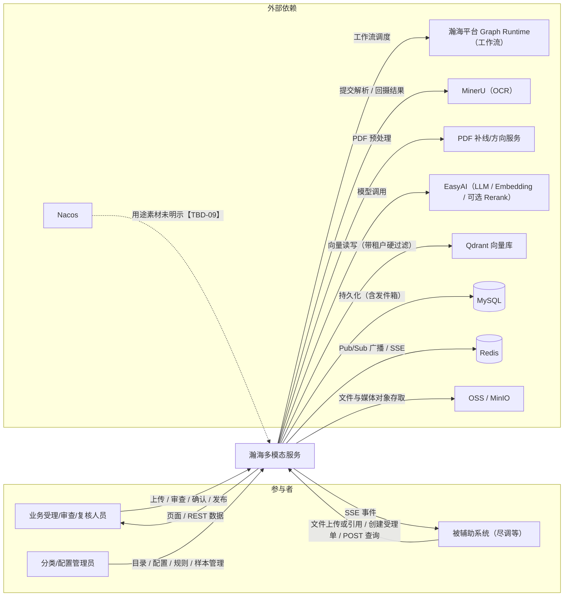
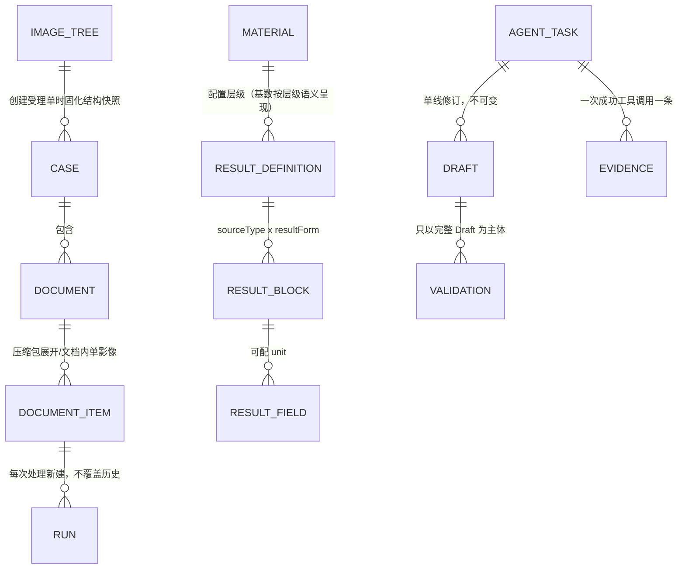

# 瀚海多模态服务需求文档（草稿）

## 1. 文档头

| 项 | 内容 |
|---|---|
| 文档状态 | 草稿（draft-v5，未定稿；按版本管控纪律，草稿期不打版本号；v1→v2、v2→v3、v3→v4、v4→v5 差异见文末修改记录） |
| 日期 | 2026-10-14 |
| 需求范围 | 瀚海智能助理系统的多模态能力服务：受理与文档接入、文档解析与识别、材料分类与样本库、结构化抽取与发布、特征提取与媒体数据、影像合规审查、对外 API 交付、实时通知、分类优化 Agent、配置与规则管理的功能需求，以及可判定的非功能需求 |
| 不在本版范围 | 系统内部模块架构与实现设计、测试用例设计本身、被辅助系统（尽调等）侧自身的功能 |
| 读者对象 | 【TBD-13】待用户确认（整理者推测：用户方、开发、测试三方共读，见附录 A） |
| 素材与口径 | 本稿整理自《瀚海多模态服务需求总览（测试参考）》V1.1（2026-10-08）。素材混合「需求文档口径」与「dev 分支代码现状（至 2026-09-29）」，凡从代码反推出的行为均随条目标注实现状态；需求口径按目标态还是按当前实现取用，见【TBD-10】 |
| 实现状态标注 | 沿用素材口径：【已实现】= 当前行为可测；【部分实现】= 已有轻量能力，完整需求未落地；【待实现】= 未开发。标注仅为现状信息，不代表需求口径已定 |

## 2. 背景与目标

### 2.1 业务痛点

【TBD-01】素材未说明建设该系统要解决的业务痛点与价值（谁、在什么业务中、因什么而低效或出错或不可控）。待用户补充一两句事实性叙述。痛点不成立，后续功能即无本之木，此项为背景层最高优先级缺口。

### 2.2 目标（事实性陈述）

系统接收多模态文档（PDF、图片、DOCX/XLSX/PPTX、压缩包、音视频），自动完成解析识别、材料分类、特征提取、结构化抽取与数据/影像校验，经人工确认后发布结构化结果，并通过对外 API 与 SSE 事件向被辅助系统（尽调等）交付。

### 2.3 成功标准

【TBD-02】素材未给出可度量或可判定的成功标准：性能方面素材明确「无既定 p50/p95 目标值」；分类准确率、抽取准确率、人工复核工作量、单据处理时效等目标均未定义。待用户补充，否则本章为空壳，无法判定项目成败。

### 2.4 明确不做什么及原因

以下边界均可回指素材：

- 不生成、不保存尽调适配所需的 tables / unpublished 报文：尽调侧自行将已发布 schema 预展平为 CellMapper 报文，多模态只交付已发布结构（职责边界划分）。
- 不接受 process_id、node_code、影像树节点 ID、材料主键等内部标识作为对外 API 入参：对外契约不暴露内部主键（与 FR-API-21 呼应）。
- 已退役能力不得回归，出现即缺陷：旧材料核验（material_verification）的任务/API/前端/两张核验表、旧外部动态路径、business-task-list 列表、`/batches/{id}` 页面、Office 独立内存相似度分类路径、「全量重建向量」按钮与四个遗留向量域、分类优化任务的 Artifact 概念、「请勿关闭页面」提示与自动恢复（架构清理结果，按代码现状裁决）。
- 不做静默降级：配置缺失、模型不匹配、关键依赖不可用必须显式失败（GP-01），不存在无记录的绕行路径。
- 以上之外是否还有明确不做项：【TBD-15】。

## 3. 用户与场景

### 3.1 用户类清单

> 说明：用户类由素材第 5 章「前端页面与操作入口」与对外 API 调用方反推归纳（AI 推断，已标注）；各用户类的特征与使用频率素材未提供，【TBD-03】。

| 用户类 | 是谁 / 能干什么 | 主要入口 | 特征与频率 |
|---|---|---|---|
| 业务受理/审查人员 | 创建受理单、上传/追加文档、检索受理单与上传记录、确认影像分类、推进五阶段工作台、发起整单提交 | `/library`、`/cases/{caseId}`、`/businessRef/:ref` | 【TBD-03】 |
| 文档复核人员 | 上传单文件、查看最近 9 条文档、审阅抽取结果、原文证据核对、字段编辑、OCR 识别修复、确认发布 | `/documents/{id}`、`/upload` | 【TBD-03】 |
| 分类/配置管理员 | 维护材料目录与四类材料配置、影像树与业务阶段、规则与审查要点、样本库；发起并裁决分类优化任务 | `/material-config`、`/image-tree-config`、`/rule-management`、`/classification-assistant` | 【TBD-03】 |
| 被辅助系统（尽调等）及其开发方 | 文件上传或平台文件引用、创建/追加受理单、订阅 SSE 事件、POST 查询进度与结果、按分类取数 | 对外 API（`/external/*`）与 SSE `/external/events/stream` | 【TBD-03】 |

### 3.2 场景：业务受理/审查人员处理一笔业务的影像材料（端到端）

业务受理/审查人员收到一笔信贷业务的影像材料：若干 PDF 扫描件和一个打包的压缩件。他在影像中心 `/library` 创建受理单，系统按该业务线影像树固化结构快照并分配唯一受理单号（受理单绑定哪棵影像树、由谁或哪个参数选定，素材未定义【TBD-17】）；通过受理对话框上传 PDF 与压缩包，压缩包被展开为子文件逐一派发处理。随后他在受理单工作台 `/cases/{caseId}` 沿五阶段推进：解析识别阶段，PDF 走 OCR 链路（探测模型 → 候选模型路由 → MinerU 提交 → 结果摄取），完成后形成标准解析数据；影像分类阶段，系统以双路径给出仲裁结论，低置信文档进入 REVIEW_REQUIRED，他在左侧「文档列表/影像树」双视图中逐份确认影像分类（AUTO_CONFIRMED 的可直接放行）；数据提取阶段，系统按材料的结果定义完成结构化抽取与字段校验；影像审查阶段，校验场景随事实变化自动补算；结果确认阶段，他核对后执行「确认结果」，最后整单提交。

正常结果：各文档结果发布固化（携带 publishedAt 与 schemaHash），后续可被查询与对外交付。

异常分支：若影像树要求的部分必需影像未上传，详情页展示缺失清单，已上传影像仍可审查，但整单提交被拦截并返回缺失影像清单；若某 PDF 的 OCR 提交失败或证据 Profile 未就绪，该文档进入显式失败状态，他可在审阅页看到失败原因，其中 OCR 识别错误可通过识别修复编辑器人工修正。

### 3.3 场景：尽调系统经对外 API 委托处理并取数

尽调侧工程师要为一笔业务取结构化材料数据。他先取得文件凭证：或调用方先经平台上传拿到 platformFileId，或调 `POST /external/files/upload`（携带 Idempotency-Key）拿到 uploadId 与有效期。随后 `POST /external/cases/create` 提交 businessRef、工作模式与文档清单（每个文档只带两种凭证之一），系统受理后经 SSE 推送 RESULT_AVAILABLE 事件（必带 resourcePath、resourceMethod=POST、businessRef）。他按 eventId 幂等消费事件，再 POST 查询进度接口与七个单文档结果接口；对批量取数，按 materialCode 调按分类取数接口，命中多份时全部返回且顺序固定。

正常结果：拿到带 publishedAt 与 schemaHash 的已发布结构化数据。

异常分支：按分类取数命中 0 份时返回 200 + 空 items（不是 404）；materialCode 不存在时返回 MATERIAL_NOT_FOUND，两者严格区分；部分影像未完成时单项带 withheldReason（AWAITING_FINAL_CONFIRMATION / RESULT_NOT_READY / RESULT_FAILED），不影响其余影像返回；重试时同键同内容重放首次结果，同键不同内容得到 409 IDEMPOTENCY_CONFLICT；受理请求 PROCESSING 超过 15 分钟由系统自动恢复（未建单记失败可重试、已建单续收、已有文档补记成功）。

### 3.4 场景：分类/配置管理员配置分类并用 Agent 优化

分类/配置管理员在材料配置中心为新材料配置智能分类项（语义判断、关键识别词、别名、负向证据），并用案例验证与效果统计检查配置效果。某类材料持续被分错时，他在智能分类助手创建「优化分类」任务并选定目标分类，系统冻结案例样本、文档运行版本、当前执行与人工确认结果、配置基线与预算。Agent 运行中仅能使用三个注册工具检索证据与生成草案修订，每产生新 Draft 自动执行两项必验（当前案例路径 A 真实试算 + 分类回归）；他在三栏工作台观察运行上下文、运行信息与草案产物，进度由 SSE 事件驱动刷新。最新 Draft 两项必验全部 PASSED、hash 匹配且输入无漂移时任务达到 READY_FOR_REVIEW，他查看草案与验证结果后走草案发布门禁确认发布。

异常分支：Agent 连续重复无进展时先被拒绝原计划强制改证据问题，再重复则结构化阻断；预算耗尽得到结构化阻断提示（不隐藏续跑）；验证失败不是任务失败，失败 Draft 携带 errorCode / suggestedFocus 进入下一轮。注意：人工暂停/恢复/取消/退回/修订当前未实现（见 5.9.3），场景中不可依赖。

### 3.5 场景：文档复核人员审阅、修正与发布

文档复核人员在文档审阅工作台 `/documents/{id}` 打开一份抽取完成的文档，切换子文件，在原文预览中查看字段级证据高亮（block/region/页码/坐标/原文）。他核对抽取结果页签中的结果块与字段；发现识别错误时用识别修复编辑器修正 OCR 结果，发现字段错误时直接编辑字段。发布前系统执行字段校验与数据勾稽（等值/合计/加减），失败则阻止发布并给出缺失/阻断项清单；他补正后重新校验。配置单位与材料实际单位不一致且值非零时，字段值保持原始值不换算，仅以 unitWarning 附带配置单位与来源单位。确认无误后执行发布，结果固化且携带 publishedAt 与运行绑定的 schemaHash，此后不可再改。

异常分支：目标不存在、多候选无法唯一、证据范围不成立、配置不完整、region 类型不匹配时，该来源显式失败并记录任务/定义/块/来源/目标名/原因，系统禁止全文回退或默认选首项。

## 4. 系统总览

### 4.1 一段话

瀚海多模态服务是瀚海智能助理系统的多模态能力服务：把进入系统的各类文档自动解析、分类、抽取成结构化结果，保留证据链与审计，经人工确认后发布，并以固定路径 API 与 SSE 事件向被辅助系统交付；全链路遵循「显式失败、不静默降级、每次处理新 Run、发布固化」四条主线。

### 4.2 主链路

一条文档的完整生命周期（三十秒读懂主干）：

```text
上传/受理 → 文件画像与预处理 → 解析（OCR / Office 原生 / 媒体解析）
→ 内容标准化与信息增强 → 材料自动分类（双路径）→ [人工确认（按需）]
→ 特征提取 → 结果定义冻结与结果块定位 → 结构化抽取与字段校验
→ 数据关系校验 → 人工复核 → 发布 → 对外查询 / SSE 通知交付
```

工作流共 28 个节点，按簇：输入准备 → OCR 决策 → 内容治理 → 业务分类（business_classify，唯一人工交互节点）→ 特征提取（feature_config_resolve / feature_extract）→ 抽取准备 → 坐标与上下文 → 结果生产。另有三条入口：Office 原生解析、压缩包批次、完整重处理。

受理单（Case）链路：创建受理单（固化影像树快照）→ 追加文档 → 五阶段工作台（解析识别 → 影像分类 → 数据提取 → 影像审查 → 结果确认）→ 整单提交（齐全性校验拦截）。

### 4.3 上下文图（系统边界）



各依赖不可用时的行为见 7.1 依赖清单（多数未定义，【TBD-09】）。

### 4.4 核心实体与关系



> 图注：MATERIAL 与 RESULT_DEFINITION 等配置层级的具体基数素材未明示，连线按「配置层级」语义呈现，非素材原文。

### 4.5 全局业务原则（跨域通用，编号 GP）

- **GP-01 显式失败**：配置缺失、模型不匹配、关键依赖不可用必须显式失败（fail fast）；出现静默换模型、静默换路径、补隐藏默认值即违反。
- **GP-02 Run 隔离**：每次处理生成新 Run（document_item_run_id）；历史结果静默混入当前结果、或重处理/重新抽取覆盖历史记录即违反。
- **GP-03 配置快照**：运行期冻结配置快照与版本（策略/模型/Prompt/算法）；运行中修改配置影响了已执行阶段即违反。
- **GP-04 发布固化**：发布后的结果不可再改；结果必须携带 publishedAt 与运行绑定的 schemaHash，缺任一即违反。
- **GP-05 结果发布门禁**：结果发布前校验（字段校验、数据勾稽、就绪检查）失败必须阻止发布并显式给出缺失/阻断项清单；校验失败仍可发布、或清单缺失即违反。
- **GP-06 业务结论非传输错误**：业务结论（如校验 NOT_PASSED、审查不通过）不是 HTTP 错误，接口仍返回 200，结论在响应体中；把业务结论实现为非 200 状态码即违反。
- **GP-07 降级判定**：外部依赖不可控时，只有允许业务继续处理且显式记录原因才算降级；未记录原因的绕行即违反。

## 5. 需求主体

> 本章按用户可见的功能域组织（受理 → 解析 → 分类 → 抽取 → 特征 → 审查 → 对外交付 → 通知 → Agent 优化 → 配置支撑），不镜像内部模块架构。每章结构：为什么存在 → 叙述 → 规则（行为级，编号 FR-xxx）→ 参数 → 异常路径。

### 5.1 受理与文档接入【已实现】

**为什么存在**：业务受理/审查人员需要按业务的影像树组织一批文档、控制齐全性并推进审查（场景 3.2）；被辅助系统需要以受理单为单位批量委托处理（场景 3.3）。

**叙述**：受理单是业务维度的容器，创建时固化影像树结构快照；文档经三个渠道进入，在受理单内按影像树节点归位，靠齐全性规则保证提交前不缺件。

**规则**

- FR-ACC-01 受理单全系统唯一 caseNo；创建时固化影像树结构快照（影像树选定机制未定义【TBD-17】）；领域模型为受理单 → 文档 → 子文件，无关联表、无树版本。
- FR-ACC-02 接入渠道三：前端上传页（单文件）、受理单受理对话框、对外 API（见 5.7）。
- FR-ACC-03 影像节点配置「是否必需 + 是否参与齐全性校验」；免校验影像不阻断整单提交，但必须明示其免校验状态。
- FR-ACC-04 缺失必需影像时：详情页展示缺失清单；已上传影像仍可审查；整单提交被拦截并返回缺失影像清单。
- FR-ACC-05 业务阶段配置含编码/名称/说明/启用/默认执行阶段/是否允许续跑，编码唯一；阶段间无固定顺序；执行前校验前置条件（识别完成、数据提取完成），不满足即拦截。
- FR-ACC-06 同一阶段重复执行覆盖该阶段原结果；续跑接口按 caseNo + 阶段编码定位。
- FR-ACC-07 审查要点绑定影像节点或整树，且必须关联至少一个业务阶段；无阶段绑定的审查要点在配置校验时失败。
- FR-ACC-08 受理配置不建版本快照；修改配置不主动重算存量受理单，重新校验/提交/续跑时按最新配置执行。
- FR-ACC-09 工作台左侧「文档列表/影像树」双视图切换且保持同一当前影像；用户确认动作只有「确认影像分类」与「确认结果」两个，出现第三个确认动作即违反。
- FR-ACC-10 业务编号深链 `/businessRef/:ref` 定位受理单后跳 `/cases/{caseId}`；查无或失败时留在深链页内报错，不得猜测跳转、不得回退旧页面。
- FR-ACC-11 影像中心 `/library`：受理单一级列表为分页视图，可与上传记录二级视图切换；支持按文件名/受理单号/业务编号/影像树名称多条件检索。
- FR-ACC-12 上传工作台 `/upload`：单文件上传（见 FR-ACC-02）；可查看最近 9 条文档并进入文档库。

**异常路径**：business-task-list 列表与 `/batches/{id}` 页面已退役，出现即缺陷。

### 5.2 文档解析与识别【已实现】

**为什么存在**：分类与抽取都以机器可读的解析结果为前提；解析域决定每种文件形态如何变成标准解析数据（服务场景 3.2 第一步、3.5 的证据基础）。

**叙述**：按文件类型路由到 OCR、Office 原生或媒体解析三条链路；无论哪条链路，产出统一汇入 Document Evidence Profile，供分类与抽取共用。

**规则**

- FR-PAR-01 解析路由：PDF/图片 → OCR 链路（探测模型 → 候选模型路由 → MinerU 提交 → 结果摄取）；DOCX/XLSX/PPTX → Office 原生解析（五节点后汇入与 OCR 相同的分类抽取尾段）；压缩包 → 展开为子文件逐一派发；音视频 → 独立媒体解析路由，不进 OCR 流程。
- FR-PAR-02 Office 与非 Office 统一：都建立 Document Evidence Profile（版本 `extraction-{documentItemRunId}`，全部证据 embedding 完成才 READY），共用同一分类执行服务；前台出现「Office 特殊算法」标识即违反。
- FR-PAR-03 审阅页提供 OCR 人工修复（识别修复编辑器）。

**异常路径**

- Profile 非 READY（部分 point 写失败）→ 该文档分类显式失败并持久化原因，不降级。
- 解析失败（OCR 提交失败、Office 内容未持久化）→ 显式失败状态，可从审阅页看到原因。
- 压缩包子文件独立分类，压缩包整体分类结果静默套用到子文件即违反。

### 5.3 材料分类与样本库【已实现】

**为什么存在**：分类决定后续用哪套结果定义做抽取，是自动化链路的分岔点；样本库让已确认的判断沉淀为可复用资产（服务场景 3.2 影像分类阶段、3.4 配置与优化）。

**叙述**：双路径并行——路径 A 对所有材料做确定性计分，路径 B 与人工确认过的样本匹配；两者交叉仲裁出自动确认、人工复核或无匹配三种结果。

**规则**

- FR-CLS-01 路径 A 冷启动评分为确定性计分内核，通道权重与确认线见参数表；Rerank 为显式配置项，启用后仅做有限重排，不改变确认语义。
- FR-CLS-02 路径 B 样本匹配：全文哈希 EXACT，或代表页双向余弦相似度 S1 ≥ 0.90 且领先差 ≥ 0.08（参数表）。
- FR-CLS-03 仲裁输出三种结果：AUTO_CONFIRMED / REVIEW_REQUIRED / NO_MATCH；双路径交叉冲突 → 一律 REVIEW_REQUIRED。
- FR-CLS-04 自动分类结果不自动入样本库；仅人工确认后进入样本库；样本库为四态管理（待确认 → 已启用等），入库前按去重线（0.98）去重。
- FR-CLS-05 受理单内文档的分类候选只来自「已启用材料目录」（2026-09-29 生效口径）；独立文档走全局目录。
- FR-CLS-06 RECOGNITION_ONLY 工作模式的文档拒绝分类。
- FR-CLS-07 任务显式请求 requestedMaterialCode 时：校验材料存在、启用、媒体类型匹配后直接确定并跳过智能分类，且不得被自动分类覆盖；不匹配 → 明确失败。
- FR-CLS-08 分类执行审计入快照（Top 候选、分项贡献、得分），可在页面查询。
- FR-CLS-09 REVIEW_REQUIRED 的人工处置：工作台「确认影像分类」动作完成确认；确认后的分类终态命名与后续行为素材未定义【TBD-04】。

**参数**

| 参数 | 值 |
|---|---|
| 通道权重（初始，全局可调） | 文件名 0.25 / OCR 关键词 0.60 / 描述语义 0.15 |
| 负向证据最多扣分 | 0.20 |
| 自动确认线 | 最终分 ≥ 0.60 且领先差 ≥ 0.08 |
| 样本相似门槛 | S1 ≥ 0.90 且领先差 ≥ 0.08 |
| 样本代表页上限 | 12（默认，`HANHAI_CLASSIFICATION_SAMPLE_MAX_PAGES`） |
| 样本去重线 | 0.98 |

### 5.4 结构化抽取、校验与发布【已实现】

**为什么存在**：结构化结果是被辅助系统取数的最终交付物；抽取域把「文档内容」变成「可查询、可勾稽、可追溯的字段」（服务场景 3.5、3.3 取数）。

**叙述**：配置层级为材料分类 → 结果定义 → 结果块 → 结果字段；抽取分两阶段——先按来源定位（整份文档/表格/图形/章节），再在来源范围内召回字段；证据随字段留存，校验通过后人工复核发布。

**规则**

- FR-EXT-01 结果块 `sourceType`：DOCUMENT（整份）/ TABLE / GRAPH / SECTION；后三者必填目标名称（可选别名、定位提示），缺失即阻断发布或执行。
- FR-EXT-02 结果块 `resultForm`：SINGLE（单条，0-1 行）/ LIST（明细多行）；旧 blockType（FIELDS 等）已废弃，系统内存在 FIELDS 来源类型即违反。
- FR-EXT-03 通用结构规则固化在代码；业务名称/别名/定位提示来自配置，硬编码「资产负债表」这类业务词即违反。
- FR-EXT-04 禁止跨结果块扁平合并后全文召回；禁止扫描 Markdown/文件名定位来源。
- FR-EXT-05 目标不存在、多候选无法唯一、证据范围不成立、配置不完整、region 类型不匹配 → 显式失败并记录（任务/定义/块/来源/目标名/原因）；出现全文回退或默认选首项即违反。
- FR-EXT-06 LLM 协议：SINGLE 只收对象、LIST 只收完整记录数组；禁止按列提取后拼接；结构不符明确失败，不自动包装、不取首项。
- FR-EXT-07 embedding 不可用 → 明确失败，不静默降级。
- FR-EXT-08 字段级证据保留 block ID、region ID、页码、坐标、原文；LIST 保留记录内字段关联，按列拆散存储即违反。
- FR-EXT-09 单位约定：字段可配 unit（≤128 字符，语义标签非换算规则）；配置单位与材料实际单位 sourceUnit 均确定、不一致且值非零 → 字段值包装 `{value, unitWarning{code:UNIT_MISMATCH, configuredUnit, sourceUnit, message}}`，value 保持原始值不换算。
- FR-EXT-10 字段校验（result_field_validate）与数据关系勾稽（等值/合计/加减，支持误差容差与空值策略，由规则管理页配置、规则引擎执行）失败 → 阻止发布（GP-05）。
- FR-EXT-11 发布：人工复核后固化，带 publishedAt 与 schemaHash（GP-04）。

### 5.5 特征提取与媒体数据【已实现】

**为什么存在**：音视频与影像材料除文本抽取外还需要客观特征事实（画面、转写、质量信号）供业务侧使用与展示（服务场景 3.2 数据提取阶段、3.5 审阅）。

**叙述**：每材料两个独立开关控制是否做特征提取与结构化抽取；特征只记录事实与证据、不产业务结论；音视频先转成与 OCR 等价的标准解析数据再进统一抽取。

**规则**

- FR-FET-01 旧「材料核验」（material_verification）已整体移除（任务、API、前端、两张核验表不存在）；再按旧口径测核验结论或出现相关入口即为缺陷。
- FR-FET-02 每材料两个独立开关：`featureExtractionEnabled`（关 → 记 SKIPPED_DISABLED）、`dataExtractionEnabled`（关 → 仍做媒体解析展示，仅跳过结构化抽取）；配置缺失/非法/模型不匹配 → 显式配置错误，不允许默认关闭。
- FR-FET-03 特征模式与作用范围两组枚举的取值见本章「枚举」表。
- FR-FET-04 特征结果只记事实/值/置信度/证据，不产生通过/不通过、风险等级等业务结论（智能验证规则属后续迭代，当前不存在）。
- FR-FET-05 模型治理：配置只存 modelRouteRef，模型目录声明能力（IMAGE_VISION / VIDEO_FRAME_VISION / ASR），运行时校验匹配；不匹配显式失败，静默换模型即违反。
- FR-FET-06 音视频先生成与 OCR 等价的标准解析数据（内容单元与定位字段见本章「枚举」表），再进统一抽取；字段来源可配。
- FR-FET-07 媒体预览：播放器 + 转写点读跳转 + 抽样帧定位；`GET .../media-preview` 返回 1 小时有效对象存储 URL 且响应禁缓存。
- FR-FET-08 特征证据 `GET .../feature-evidence` 按当前处理批次 + 特征配置哈希查询；配置 A→B→A 时按 hash 复用旧证据，误取最新配置证据即违反。
- FR-FET-09 特征依据展示模型实际输入：视频显示实际采用帧与输入拼图（点击定位时间）、音频显示所用转写文本、PDF 特征范围当前为首页并显示页码（现状口径）。

**枚举**

| 枚举 | 取值 |
|---|---|
| 特征模式 | DETERMINISTIC（不调模型）/ MODEL / HYBRID |
| 作用范围 | MEDIA / PAGE / REGION / FRAME / VIDEO_SEGMENT / AUDIO_SEGMENT |
| 媒体内容单元（6 类） | PAGE / TRANSCRIPT_SEGMENT / SCENE_SEGMENT / VIDEO_FRAME / MEDIA_METADATA / OCR_TEXT |
| 媒体定位字段 | frameNo / startMs / endMs / speaker 等（素材口径为「含……等」，非穷举） |

### 5.6 影像合规审查【部分实现】

**为什么存在**：整单提交前需要按规则集对影像与数据做合规性判断，拦截缺件与不合格影像（服务场景 3.2 影像审查阶段）。

**叙述**：当前已实现基于影像树规则集 + 业务阶段的两类校验场景，核心机制是「事实变化自动补算」；完整审查引擎（六态/严重度/建议/受控检查类型）为目标态未落地，是否纳入本版需求口径见【TBD-10】。

#### 5.6.1 当前实现行为（可测范围）

- FR-REV-01 校验场景：IMAGE_REVIEW（影像审查）与 DATA_VALIDATION（数据校验），入口 `/cases/{caseId}/image-validation`、`/validation-report/{scene}`。
- FR-REV-02 按规则依赖自动补算：新增影像、影像分类确认、提取工作版本变化、人工修正等事实变化 → 自动重判受影响影像；无用户「开始审查」按钮（出现即违反现行口径）。
- FR-REV-03 补算任务与输入变更同事务持久化；连续变更合并待办并使旧领取令牌失效。
- FR-REV-04 规则级输入指纹跳过未变化规则。
- FR-REV-05 缺依赖 → 待处理而非失败。

#### 5.6.2 完整审查引擎（目标态，未实现，当前不可测）

- FR-REV-06 审查点六态与运行六态取值见下表；汇总优先级：ERROR > NOT_EXECUTED > BLOCKING FAIL > UNDETERMINED > PASS，前三类不得计为通过。
- FR-REV-07 严重度与建议编码取值见下表；模型只产视觉事实与受控摘要，不改状态/严重度/建议；证据不足 → UNDETERMINED，不造证据。
- FR-REV-08 14 种受控检查类型的类目见下表。
- FR-REV-09 运行幂等（同 case + 输入版本 + 策略版本仅一个有效运行）；策略生命周期 DRAFT → PUBLISHED → DEPRECATED；API 只读。

**状态与枚举（目标态）**

| 类别 | 取值 |
|---|---|
| 审查点六态 | PASS / FAIL / UNDETERMINED / NOT_APPLICABLE / NOT_EXECUTED / ERROR |
| 运行六态 | PENDING / RUNNING / COMPLETED / COMPLETED_WITH_ERRORS / FAILED / CANCELLED |
| 严重度（3 级） | INFO / WARNING / BLOCKING |
| 建议编码（6 项） | NO_ACTION / SUPPLEMENT_MATERIAL / REUPLOAD_DOCUMENT / RECAPTURE_IMAGE / CORRECT_PAGE_ORDER / BLOCK_IMAGE_SUBMISSION |
| 受控检查类型（14 种） | 字段必填/枚举/格式/比较、日期、数值/公式勾稽、存在性、质量信号、视觉断言（素材按类目概列，14 条明细未逐项展开） |

### 5.7 对外 API 交付【已实现】

**为什么存在**：被辅助系统（尽调等）以机器方式委托处理与取数，是对外交付的主通道（服务场景 3.3）。

**叙述**：文件两种来源二选一进入，受理单创建后按固定路径 POST 查询与按分类取数，写操作全程幂等；对外契约不暴露任何内部主键。

#### 5.7.1 接入与受理

- FR-API-01 文件两种来源，提交时二选一：平台文件引用（调用方先经平台上传取得 platformFileId，多模态按当前请求 Authorization 拉取并校验大小与 SHA-256）；多模态上传（`POST /external/files/upload`，multipart + Idempotency-Key → 返回 uploadId 与 expiresAt，过期作废；过期后的调用行为【TBD-05】）。
- FR-API-02 创建：`POST /external/cases/create`（JSON body `{businessRef, request, documents[]}`）；每个 document 只能含 platformFileId 或 uploadId 之一，两者同传或都缺 → 400；materialCode 为可选预分类提示；受理单绑定影像树的选定机制未定义【TBD-17】；压缩包用 archiveEntries 逐条目给分类。原 multipart 创建接口保留供平滑迁移。
- FR-API-03 追加：`POST /external/cases/documents/append`。
- FR-API-04 工作模式三种：FULL_PROCESS / RECOGNITION_ONLY / AUTO_EXTRACT；创建必传 workMode；影像树/校验/审查开关按模式约束；创建后配置冻结，追加不改配置。
- FR-API-05 影像分类确认（对外入口，对应工作台「确认影像分类」）：`POST /external/cases/documents/classification-confirmation`。

#### 5.7.2 固定路径与 POST 查询

- FR-API-06 所有对外 URL 固定路径，不得含 businessRef / documentRef / materialCode / 请求号等标识，标识只放 body；出现 query string → 400 INVALID_REQUEST。
- FR-API-07 旧动态路径（GET /external/cases/{businessRef}/... 形态）不注册，返回 404，无兼容转发。
- FR-API-08 查询一律 `POST <资源>/query`，全部 11 个查询接口见本节末「POST 查询接口清单」表。
- FR-API-09 查询不是写操作：不要求 Idempotency-Key、不写请求台账、不返回 Idempotent-Replayed。
- FR-API-10 文档清单去分页：body 只允许 businessRef，一次返回全部文档，无 page/size 字段；businessRef 查无时的返回语义【TBD-06】。
- FR-API-11 识别结果接口保留分页：page 缺省 0、size 缺省 20、size 1..100，非法 → 400 INVALID_PAGE_ARGUMENT。
- FR-API-12 Markdown 下载：POST query，成功响应为 text/markdown 文件流（非 JSON 信封）。
- FR-API-13 SSE `/external/events/stream` 保持 GET，重连用 Last-Event-ID（机制见 5.8）。

**POST 查询接口清单（FR-API-08）**

| 接口（POST `…/query`） | 类别 |
|---|---|
| cases/query | 资源查询 |
| cases/progress/query | 资源查询 |
| cases/documents/query | 资源查询 |
| requests/query | 资源查询 |
| recognition-result | 单文档结果接口 |
| markdown-result | 单文档结果接口 |
| classification-result | 单文档结果接口 |
| image-feature-result | 单文档结果接口 |
| extraction-results | 单文档结果接口 |
| data-validation-result | 单文档结果接口 |
| image-review-result | 单文档结果接口 |

#### 5.7.3 按分类取数（3 个只读接口）

- FR-API-14 `POST /external/cases/classifications/{extraction-results | image-feature-results | image-review-results}/query`；body 必含 businessRef + materialCode；提取结果可另传 documentRef + fileOrdinal 精确查一份影像，两参数必须成对，否则 400；fileOrdinal 越界行为【TBD-08】。
- FR-API-15 匹配单位是子文件（fileOrdinal 从 1 起）；只匹配最终分类完全相等的子文件——候选/待确认分类不算命中；多命中全部返回，顺序固定（文档创建序 → 文档内子文件序）。
- FR-API-16 命中 0 份 → 200 + 空 items 数组（不是 404）；分类不存在 → MATERIAL_NOT_FOUND，两者严格区分。
- FR-API-17 集合接口单项化：某影像未完成/失败不影响其他影像返回；单项带 executionStatus / publicationStatus / withheldReason（AWAITING_FINAL_CONFIRMATION / RESULT_NOT_READY / RESULT_FAILED）；已发布项必须返回正式数据且不再带 withheldReason。
- FR-API-18 提取结果保留结果块结构（results → blocks → rows → fields，resultForm 仅 SINGLE/LIST）；已发布项必须带 publishedAt 与 schemaHash；无法可靠投影时仅该项标 FAILED / EXTRACTION_BLOCK_INVALID，用当前 schema 补造即违反。

#### 5.7.4 材料目录与 schema（尽调适配）

- FR-API-19 `POST /external/materials/query`：body 必须空对象 `{}`；不分页；只返回 MATERIAL + ENABLED + PUBLISHED + selectable 的分类，每项含 responseSchemaAvailable 布尔。
- FR-API-20 `POST /external/materials/response-schema/query`：按 materialCode 取已发布结构 + schemaHash；非启用 / 未发布 / 空结构 → 分别显式失败（404/409），不返回部分 schema。
- FR-API-20a 尽调侧自行预展平成 CellMapper 报文；多模态不生成、不保存 tables/unpublished 报文，不接受 process_id / node_code / 影像树节点 ID / 材料主键入参。
- FR-API-20b 现状：材料目录接口仍返回 materialTypeId（内部诊断字段，不得作为关联键使用）；「移除该字段」的需求与代码现状冲突，按哪个口径定稿【TBD-11】。
- FR-API-20c 现状：response-schema 实际返回 dataResults 树（带 `$_` 描述键）；旧需求描述的 resultDefinitions 结构口径作废，不再适用。

#### 5.7.5 幂等与请求可靠性

- FR-API-21 写操作（上传、创建、追加、分类确认）必带 Idempotency-Key；作用域 tenant_id + idempotency_key；查询/重试/取消还须匹配 X-Assisted-System-Id；终态记录保留 30 天后 404。
- FR-API-22 内容摘要 = 身份 + 请求体 + 每个文件「文件名:大小:SHA-256」；同键同内容 → 重放首次结果；同键不同内容 → 409 IDEMPOTENCY_CONFLICT；businessRef 已存在且换新键 → 409 BUSINESS_REF_EXISTS。
- FR-API-23 中断恢复：PROCESSING 超过 15 分钟 → 启动时 + 定时扫描恢复：未建单记失败允许重试；已建单未收件复用原单续收；已有文档补记受理成功且识别由既有调度继续。
- FR-API-24 requestStatus=SUCCEEDED 只代表受理成功，不等于识别完成（进度须查 progress/query）。
- FR-API-25 取消 `POST /external/requests/close`（body requestKey + businessRef）：未建单 → CANCELLED 且同键不可再建；已建单 → 不停止执行（executionStopped=false）；终态原样返回；记录不存在 → 404，把 404 解释为「从未受理」或据此触发取消即违反。

#### 5.7.6 通知与错误码

- FR-API-26 SSE 按认证租户 + X-Assisted-System-Id 订阅全量受理单（无单据级订阅参数）；RESULT_AVAILABLE 事件必带 resourcePath（固定 `/api/multimodal/external/cases/progress/query`）、resourceMethod=POST、businessRef，缺任一不得发布；调用方按 eventId 幂等消费。
- FR-API-27 统一响应信封：success / code / message / data / timestamp / traceId / errorCode；调用方按 HTTP 状态 + errorCode 分支，不得解析 message。
- FR-API-28 分类域错误码固定为下表 8 个。
- FR-API-29 响应禁止出现内部主键（caseId / documentItemId / runId）与内部存储地址（全接口响应扫描可判定）。

**分类域错误码（FR-API-28）**

| 错误码 | 注记 |
|---|---|
| INVALID_MATERIAL_CODE | — |
| FILE_NOT_FOUND | — |
| MATERIAL_NOT_FOUND | — |
| MATERIAL_NOT_PUBLISHED | — |
| MATERIAL_SCHEMA_NOT_PUBLISHED | — |
| MATERIAL_FILE_MISMATCH | — |
| MATERIAL_SCHEMA_INVALID | 422 |
| EXTRACTION_BLOCK_INVALID | 422，仅单项 |

### 5.8 实时通知与事件交付【已实现】

**为什么存在**：前端页面与外部系统都依赖事件驱动刷新与取数时机（服务所有页面用户与被辅助系统；场景 3.3 的 SSE、3.4 的进度刷新）。

**叙述**：业务事务内写发件箱，定时领取后经 Redis Pub/Sub 广播，各实例以 SSE 推送；消费端去重后重读 REST 权威资源。

**规则**

- FR-RTN-01 链路：业务事务内写 MySQL 发件箱 → 定时领取 → Redis Pub/Sub 广播 → 各实例 SSE 推送 → 前端去重合并后重读 REST 权威资源（领取间隔 200ms、批 100、租约 30 秒为实现现状参数）。
- FR-RTN-02 subject 三类：DOCUMENT（聚合）、DOCUMENT_ITEM（子文件）、CLASSIFICATION_TASK（分类优化任务）；外部 SSE 按租户 + 被辅助系统订阅。
- FR-RTN-03 内部 SSE `GET /api/realtime/events?subjects=...`：支持 Last-Event-ID 断线重放（单次上限 500 条，超限行为【TBD-07】）；至少一次投递、eventId 去重、15 秒心跳、连接超时 30 分钟；前端退避重连最大 10 秒。
- FR-RTN-04 订阅鉴权：无权限 403、不存在 404、非法请求 400。
- FR-RTN-05 基础设施不完整 → 启动失败（缺 Redis 配置时服务不得启动）；`HANHAI_REALTIME_ENABLED=false` 为显式停用。

**参数**

| 参数 | 值 |
|---|---|
| 发件箱领取间隔 / 批量 / 租约 | 200ms / 100 条 / 30 秒（实现现状口径） |
| 事件重放单次上限 | 500 条 |
| 心跳 / 连接超时 | 15 秒 / 30 分钟 |
| 前端重连退避上限 | 10 秒 |

### 5.9 智能分类助手与分类优化 Agent【部分实现】

**为什么存在**：分类质量靠配置调优，人工试错成本高；Agent 以受控工具 + 强制验证产出可审草案，替代人工盲调（服务场景 3.4）。

**叙述**：当前迭代只交付 CREATE_CLASSIFICATION（新增分类）与 OPTIMIZE_CLASSIFICATION（优化分类）两类任务；任务创建即冻结全部输入，Agent 只能在冻结输入上检索证据、生成草案修订，系统强制验证把关，达门槛后才交人工裁决。

#### 5.9.1 当前实现行为（可测范围）

- FR-AGT-01 任务创建与目标冻结：创建时冻结案例样本与文档运行版本、目标分类（优化类必填）、当前执行与人工确认结果、配置基线、用户问题与期望、算法/模型/策略版本、轮次与成本预算。
- FR-AGT-02 Agent 不得改选案例/分类/目标；改变目标必须新建任务；输入漂移（重新 OCR、Profile 漂移、基线/模型版本变化）→ 显式阻断或要求重建任务。
- FR-AGT-03 旧模式拒绝：结果定义任务类型、旧模式枚举 → 显式拒绝；不存在 AUTO_APPLY。
- FR-AGT-04 数据模型六表（opt_task / opt_agent_task / opt_evidence / opt_draft / opt_validation / opt_event）承载的行为约束：Draft 完整不可变、单线修订；同内容重复修订被拒绝（UNIQUE task_id + draft_hash）；一次成功信息获取工具调用 = 一条不可变 Evidence，失败调用只写 Event 不产生伪 Evidence；Validation 只以完整 Draft 为主体且不可变；Event append-only 幂等。
- FR-AGT-05 仅注册三项 LLM 工具：`search_current_case_classification_evidence`（冻结当前案例内向量发现 + 权威原文回读 + 确定性表达式核验；参数 queries:[{text,dimension}]，dimension 支持 OCR 正向/描述语义/负向对比；字符串数组、非法维度 → Planner 拒绝并重写计划）、`search_classification_knowledge`（受控分类/信贷知识检索，结果持久化为 Evidence）、`create_classification_draft_revision`（生成新 Draft；越权字段、无变化修订 → 拒绝）。
- FR-AGT-06 系统强制验证：LLM 计划不得选择验证工具；每产生新 Draft 自动执行两项必验——当前案例路径 A 真实试算（Top1/排名/得分/领先差/分项贡献/基线对比）+ 分类回归（覆盖目标分类、主要竞争分类、受表达式变化影响分类；空回归集 → 返回待人工确认风险，不返回 PASSED）。
- FR-AGT-07 完成门槛：最新 Draft 两项必验全部 PASSED、hash 匹配且输入无漂移 → READY_FOR_REVIEW；LLM 自报完成无效。
- FR-AGT-08 失败与预算：验证失败不是任务失败；失败 Draft + 结构化反馈（errorCode / suggestedFocus）进入下一轮；预算未耗尽自动继续，耗尽 → 结构化阻断（不隐藏续跑）。
- FR-AGT-09 无进展两级策略：第一次重复 → 拒绝原计划、强制改证据问题或修改方向；第二次连续重复 → 结构化阻断，不消耗轮次空跑。
- FR-AGT-10 界面：工作台三栏（左运行上下文 / 中 Agent 运行信息 / 右草案产物；窄屏按此序堆叠）；创建页只显示「新增分类 / 优化分类」；进度刷新 SSE 事件驱动，无固定间隔轮询心跳。

#### 5.9.2 待实现增强【TBD-12：是否纳入本版范围】

- 竞争证据分析：Job 详情「为什么会这样分类」区域（Top 3 候选分项对比、命中表达式与来源页、Top1-Top2 分差、决策状态与确认线、材料关系 6 类枚举、配置问题 7 类根因枚举）。
- 联动优化：1 个目标分类 + 最多 2 个竞争分类的多材料草案；基线哈希不匹配 → 草案校验失败；任一已确认样本回归退化 → 整草案 FAILED；确认多材料原子应用，任一失败全部回滚。
- Pi 服务端 Loop 试点、分类执行性能优化项（批量特征加载、embedding 分批、multi-query 召回、分段计时指标）。

#### 5.9.3 未实现（当前不可测，出现相关入口即为缺陷）

- 人工控制与生命周期：显式暂停/恢复/取消/归档状态流、查看任务不触发恢复、浏览器断开不取消后台任务、人工退回（execution_no 递增、trigger=HUMAN_FEEDBACK）、人工修订（新 Draft 必须重跑全部验证）。
- 界面收口残留：处理区按轮折叠与步骤图标、Draft/Evidence/Validation/人工操作新响应模型接入、「查看已发布分类」入口。

### 5.10 配置与规则管理【已实现】

**为什么存在**：分类、抽取、校验、审查的行为全部由配置驱动，管理员需要集中维护并可安全迁移（服务场景 3.4；全部自动化行为的地基）。

**规则**

- FR-CFG-01 规则管理页三块：规则场景、规则集、字段关系规则（等值/合计/加减勾稽，支持误差容差与空值策略）；提供 rule-designer 画布式设计器。
- FR-CFG-02 发布前由规则引擎强校验，失败阻止发布。
- FR-CFG-03 影像树校验规则绑定影像树 / 材料 / 业务阶段；数据校验与影像审查按文档查询，业务结论 NOT_PASSED 时 HTTP 仍 200（GP-06）。
- FR-CFG-04 服务端参数走 `.env.local`，覆盖域见本节末「服务端参数域清单」表。
- FR-CFG-05 通用识别配置（全局）：探测模型与页数、候选模型路由（文件名规则 + 结构条件）、OCR provider 参数、增强模型与页预算、分类权重与确认阈值/最低领先差。
- FR-CFG-06 材料级配置四类（材料配置中心）：智能分类（语义判断/关键识别词/别名/负向证据 + 案例验证 + 效果统计）、材料校验、结果定义（含就绪检查与执行阻断项）、样本库（四态）。
- FR-CFG-07 配置迁移：JSON 导出/导入，导入触发全量向量重建。
- FR-CFG-08 保存 ≠ 可运行：保存成功但缺失关联或存在执行阻断项时，执行必须显式停止，不补默认值；跑出半成品结果即违反。
- FR-CFG-09 向量域治理：仅保留 Document Evidence Profile、分类时动态特征向量、Agent Knowledge（启动自动对账，manifest + active marker 一致即 READY 不重复 embedding）、确认样本向量；「全量重建向量」按钮与四个遗留向量域已删除，出现即缺陷。

**服务端参数域清单（FR-CFG-04）**

| 服务端参数域（`.env.local`） |
|---|
| 环境 / Graph / 数据源 / 租户 |
| Redis 与实时通知 |
| MinerU 并发 |
| PDF 预处理 |
| 抽取 Token 预算 |
| EasyAI 模型与预算 |
| Embedding 向量契约 |
| Rerank |
| Qdrant |
| 样本代表页 |
| MinIO |
| 分类优化草案发布门禁（HANHAI_COP_*） |

## 6. 非功能需求

- NFR-01 失败可见性（可靠性）：所有显式失败均持久化原因且页面/接口可见；存在无记录的静默降级路径即违反。
- NFR-02 审计与追溯：分类执行审计快照、Agent 六表 append-only 事件、发布可追溯（Draft + Validation + 人工确认）三条审计链缺一即违反。
- NFR-03 多租户与数据隔离（安全）：证据搜索、SSE 订阅、外部请求按租户与被辅助系统隔离；向量查询带租户硬过滤，跨租户能查到数据即违反。
- NFR-04 对外契约安全：响应不得出现内部主键与内部存储地址（同 FR-API-29）；对外标识与内部标识严格分离。
- NFR-05 性能：当前无既定 p50/p95 目标值，性能以端到端耗时观测为主；分类执行分段计时指标为待实现项（5.9.2）。目标值【TBD-02】。
- NFR-06 工程门禁（可维护性）：数据库 DDL 只走受控脚本、全字段中文注释、前端体积基线、Java 源码规模治理。
- NFR-07 合规（显式空位）：素材未提供任何合规约束（数据留存期限、监管报送、行业合规要求等均未述）；按「不凑模板」纪律不硬造条目，合规维度是否判定为不适用待【TBD-18】裁决，裁决前本维度保持显式空位。

## 7. 约束、假设与开放问题

### 7.1 外部依赖清单

| 依赖 | 用途 | 不可用时行为 |
|---|---|---|
| 瀚海平台 Graph Runtime | 工作流执行 | 【TBD-09】未定义（按 GP-01 属关键依赖则应显式失败） |
| MinerU | OCR 解析 | 【TBD-09】未逐项定义；OCR 提交失败 → 文档显式失败状态（FR-PAR 异常路径） |
| PDF 补线/方向服务 | PDF 预处理 | 【TBD-09】未定义 |
| EasyAI（LLM/Embedding/可选 Rerank） | 模型调用 | embedding 不可用 → 明确失败不降级（FR-EXT-07）；LLM 部分【TBD-09】 |
| Qdrant | 向量库 | 【TBD-09】未定义 |
| MySQL | 持久化（含发件箱） | 【TBD-09】未定义 |
| Redis | Pub/Sub、实时通知 | 基础设施不完整 → 启动失败（FR-RTN-05） |
| OSS/MinIO | 文件与媒体对象存储 | 【TBD-09】未定义 |
| Nacos | 素材未明示用途 | 【TBD-09】用途与不可用行为均未定义 |

总口径（素材可支撑）：外部依赖不可控时，只有允许业务继续处理且显式记录原因才算降级（GP-07）。

### 7.2 前提假设

- 多租户运营，租户与被辅助系统标识（tenant_id、X-Assisted-System-Id）贯穿受理、幂等与订阅。
- 被辅助系统（尽调等）具备平台文件上传能力或改用多模态上传；尽调侧自行完成 schema 预展平。
- 服务端参数与配置体系（`.env.local` + 配置中心）可用且受控。
- 前端支持独立运行与瀚海 portal 嵌入两种挂载形态；嵌入视图下页面背景已统一适配（2026-09-25）。

### 7.3 开放问题

全部开放问题集中列于附录 A（TBD-01 ~ TBD-18），不带入定稿。需求口径类（TBD-10/11/12）影响本文档写法，优先裁决。

## 8. 术语表与变更记录

### 8.1 术语表

| 术语 | 含义（与正文用法一致） |
|---|---|
| 业务受理/审查人员 | 用户类（3.1）：创建受理单、上传/追加文档、确认影像分类、推进五阶段工作台、发起整单提交 |
| 文档复核人员 | 用户类（3.1）：审阅抽取结果、原文证据核对、字段编辑、OCR 识别修复、确认发布 |
| 分类/配置管理员 | 用户类（3.1）：维护材料目录/影像树/业务阶段/规则/样本库，发起并裁决分类优化任务 |
| 受理单（Case / MultimodalCase） | 业务维度容器，唯一 caseNo，创建时固化影像树结构快照 |
| 影像树 | 受理单内文档的组织树，节点对应影像并配置受理要求 |
| 文档（Document） | 一次提交进入的文件单元（单文件或压缩包） |
| 子文件（Document Item，素材亦称「子文档」） | 压缩包展开或文档内的单份影像；fileOrdinal 从 1 起 |
| Run（处理批次，document_item_run_id） | 每次处理生成的独立执行记录，不覆盖历史 |
| Document Evidence Profile | 文档证据档案（版本 extraction-{runId}），全部证据 embedding 完成才 READY |
| 材料分类（materialCode） | 材料目录中的分类项，决定结果定义 |
| 双路径分类 | 路径 A 冷启动评分 + 路径 B 确认样本匹配，交叉仲裁 |
| AUTO_CONFIRMED / REVIEW_REQUIRED / NO_MATCH | 分类仲裁三态 |
| 样本库 | 人工确认后沉淀的确认样本（四态管理，去重线 0.98） |
| 结果定义 / 结果块 / 结果字段 | 抽取配置层级；结果块由 sourceType × resultForm 描述 |
| schemaHash | 与运行绑定的结果结构哈希，随发布携带 |
| 影像分类确认 | 工作台「确认影像分类」动作；对外接口名 classification-confirmation，同一动作两个入口 |
| 发布 / 固化 | 发布是人工确认动作，固化是其效果：发布后结果不可再改 |
| 结果发布门禁 | GP-05：结果发布前校验（字段校验、数据勾稽、就绪检查）失败必须阻止发布并给出缺失/阻断项清单 |
| 草案发布门禁 | 分类优化 Agent 草案的发布控制（参数 HANHAI_COP_*，见 5.9 / FR-CFG-04）；与结果发布门禁是两个独立机制，互不共用 |
| 工作模式 | FULL_PROCESS / RECOGNITION_ONLY / AUTO_EXTRACT |
| 被辅助系统（尽调等） | 经对外 API 与 SSE 消费结果的下游系统，以 X-Assisted-System-Id 标识 |
| Idempotency-Key | 写操作幂等键，作用域 tenant_id + key，终态保留 30 天 |
| Draft / Evidence / Validation / Event | Agent 域四类不可变记录：草案修订 / 证据 / 验证 / 追加事件 |
| READY_FOR_REVIEW | Agent 任务完成门槛态（两项必验 PASSED + hash 匹配 + 无漂移） |
| 就绪检查 / 阻断项 | 结果定义上的配置项，属结果发布门禁（GP-05）的校验组成；阻断项存在时执行显式停止 |
| 勾稽校验 | 数据关系校验（等值/合计/加减，含误差与空值策略） |
| SSE | Server-Sent Events；内部 `/api/realtime/events` 与外部 `/external/events/stream` 两条通道 |

### 8.2 变更记录

| 版本 | 日期 | 变更 | 依据 |
|---|---|---|---|
| 草稿 draft-v1（未打版本号） | 2026-10-14 | 初稿：由素材《瀚海多模态服务需求总览（测试参考）》V1.1 整理成八层骨架；开放问题以 TBD-01~16 列出待确认 | 素材 V1.1（2026-10-08） |

---

## 附录 A 待用户确认的问题清单

> 题型仅限：填空（问未定义的行为）、选择（给方案与后果）、确认（写整理者理解请纠正）。消歧完成后本清单清空，TBD 标注同步移除。

### 填空题（未定义行为）

- **TBD-01 业务痛点**：本系统解决什么业务痛点、创造什么价值？（背景层核心缺口，素材全篇未述。影响：2.1 节为空，无法评判后续功能的必要性。）
- **TBD-02 成功标准**：请给出可度量/可判定的成功标准（如分类准确率、抽取准确率、人工复核工作量、端到端时效 p50/p95）。素材明确当前无既定性能目标。影响：2.3 与 NFR-05 无法判定。
- **TBD-03 用户画像**：四个用户类（受理/审查、复核、配置管理、被辅助系统）各自的特征与使用频率是什么？影响：3.1 表缺列。
- **TBD-04 分类人工终态**：REVIEW_REQUIRED 的文档经人工「确认影像分类」后，分类终态叫什么、后续行为是什么（是否入样本库候选、是否可再改）？素材未定义。影响：FR-CLS-09 状态链断头。
- **TBD-05 上传过期行为**：uploadId 超过 expiresAt 后再用于创建受理单，返回什么错误（错误码/HTTP 状态）？素材仅写「过期作废」。
- **TBD-06 清单查无行为**：`cases/documents/query` 的 businessRef 无对应受理单时返回什么（404 还是 200+空列表）？素材未定义。
- **TBD-07 SSE 重放超限**：Last-Event-ID 距今事件超过单次 500 条上限时，行为是什么（只回最近 500 条 / 断开让客户端全量重读 / 其他）？素材未定义。
- **TBD-08 fileOrdinal 越界**：fileOrdinal 超出该文档实际子文件数（或与 documentRef 不匹配但成对出现）时返回什么？素材未定义。
- **TBD-09 依赖降级矩阵**：Graph Runtime、MinerU、PDF 服务、LLM、Qdrant、MySQL、OSS、Nacos 各自不可用时，逐项行为是什么（哪些属「关键依赖」fail fast，哪些允许显式降级续跑）？素材只给 Redis（启动失败）与 embedding（明确失败）两个个例和一条总原则。
- **TBD-17 影像树选定机制**：创建受理单时绑定哪棵影像树、由谁或哪个参数选定（按业务线自动映射，还是创建请求 request 显式传参；对外 API 与前端受理是否同一机制）？素材未定义。影响：FR-ACC-01、FR-API-02 创建契约、场景 3.2 第一步。

### 选择题（方案与后果）

- **TBD-10 需求口径**：本文档按哪种口径定稿？
  - 方案 A：需求 = 目标态（含【部分实现】目标态与【待实现】项），实现状态仅作测试参考标注。后果：文档稳定、指引演进；测试需自行按状态裁剪范围。
  - 方案 B：需求 = 当前已实现行为，目标态与待实现项移入开放问题。后果：文档与现状零偏差；每次实现推进需同步改需求。
- **TBD-11 materialTypeId 字段**：需求要求移除、代码保留（素材第 9 章第 6 条）。
  - 方案 A：维持「移除」要求，登记为实现偏差待改，测试按现状测。后果：留下待办，需求与代码终将一致。
  - 方案 B：接受现状，需求改为「保留但标注内部诊断字段、不得作为关联键」。后果：契约固化现状，尽调方需规避使用。
- **TBD-12 待实现范围**：分类助手增强（竞争证据分析、联动优化、Pi Loop、性能优化项）是否纳入本版需求？
  - 方案 A：纳入，标注【待实现】。后果：范围完整，回归规划有依据。
  - 方案 B：移出本版，列入开放问题待下版。后果：本版范围收紧，只管已实现与部分实现域。

### 确认题（整理者理解，请纠正）

- **TBD-13 读者对象**：理解为本文档供三方共读——用户方（业务/尽调方代表）看背景、场景与范围；开发看行为规则与约束；测试看可判定断言。是否准确？
- **TBD-14 范围边界**：理解为本版覆盖素材全部功能域（5.1~5.10）+ 非功能 + 对外契约，不含内部模块架构设计与测试用例设计本身。是否准确？
- **TBD-15 不做清单**：2.4 的五条「明确不做」是否完整？是否还有其他明确不做的事项及原因？
- **TBD-16 术语统一**：素材中「子文件/子文档」统一为「子文件」、「分类确认（API）/确认影像分类（工作台）」认定为同一动作两入口、「被辅助系统/尽调/外部系统」统一为「被辅助系统（尽调等）」。是否与业务方实际叫法一致？
- **TBD-18 合规维度**：素材全文无合规内容。整理者理解为合规维度对本系统不适用（无数据留存期限、监管报送、行业合规等约束）——是否准确？若适用，请给出具体合规约束。影响：NFR-07 当前为显式空位。

## 附录 B 自查报告（五查留痕）

| 查 | 发现 | 处置（改了什么） |
|---|---|---|
| 1 查出处（逐条回指素材） | ① 素材 2.2「模块组成表」（Maven 模块 + 测试视角列）属实现与测试分工信息，非需求意图；② 读者对象、业务痛点、成功标准三类意图信息素材缺失；③ 3.1 用户类清单系从素材第 5 章页面/入口反推，属 AI 推断；④ 4.4 实体关系图中配置层级基数素材未明示；⑤ FR-API-20b（materialTypeId）来自素材第 9 章不一致清单，属代码反推 | ① 不纳入正文，文档头「不在本版范围」声明；② 正文置【TBD-01/02/13】空位，不编造；③ 3.1 表上方显式标注「AI 推断」；④ 图注声明基数按层级语义呈现；⑤ 条目按现状描述并标注冲突，出 TBD-11 送人裁决（符合 skill「从代码反推必须标注送人确认」）。其余条款均回指素材 2.3/3/4.x/6/8 章原文，无凭空补充 |
| 2 查可判定（每条规则自问「怎样算违反」） | ① 素材「Office 与非 Office 分类处理统一」原句抽象，无法判定违反；② 「保存 ≠ 可运行」原句为口号式；③ NFR「失败可见性」原句缺违反判据；④ 全文逐条复核，个别条款补写「即违反」判据 | ① 改写为 FR-PAR-02（都建 Profile + 共用同一分类执行服务 + 前台出现「Office 特殊算法」标识即违反）；② 改写为 FR-CFG-08（缺关联/有阻断项时执行必须显式停止，跑出半成品即违反）；③ 落为 NFR-01（存在无记录的静默降级路径即违反）；④ GP/FR/NFR 各条均带可判违反情形或参数边界 |
| 3 查打架（条款矛盾） | ① 素材 4.8.1「原 multipart 创建接口保留」与 4.8.2「旧动态路径不注册（404）」并读易成矛盾；② 需求「移除 materialTypeId」vs 代码保留，为真实需求-实现冲突；③ 「Rerank 可选」与 GP-01「不允许静默换模型」有潜在误读；④ 数值参数（0.25/0.60/0.15/0.20/0.60/0.08/0.90/0.98/12/15min/30d/500/15s/30min/10s/1h/128/9）与素材第 8 章速查表逐一核对 | ① 核实为两类旧接口（multipart 创建保留、动态查询路径退役），FR-API-02 与 FR-API-07 分别写明各自适用对象，消除歧义；② 不擅自定口径，出 TBD-11 选择题，正文 FR-API-20b 标注双口径；③ FR-CLS-01 写明「Rerank 为显式配置项，仅有限重排，不改变确认语义」，与 GP-01 划清界线；④ 数值全部一致，无冲突 |
| 4 查漏（状态机去向 + 边界穷举） | ① 分类三态中 REVIEW_REQUIRED 的人工处理后终态未定义（状态链断头）；② uploadId 过期后调用行为只写「作废」，返回未定义；③ 文档清单查询 businessRef 查无行为未定义；④ SSE 重放超 500 条行为未定义；⑤ fileOrdinal 越界行为未定义；⑥ 外部依赖除 Redis/embedding 外，逐项不可用行为未定义；⑦ Agent 任务 READY_FOR_REVIEW 后的人工处置流缺失——素材已声明未实现，非隐蔽漏项；⑧ 空输入（materials/query 空 body）、分页越界（400 INVALID_PAGE_ARGUMENT）、临界归属（≥0.60、≥0.08、≥0.90 均含等号）、超时（PROCESSING 15 分钟）素材已覆盖 | ①~⑥ 各出填空题 TBD-04~09，正文对应位置标注【TBD】，不以推测补行为；⑦ 归入 5.9.3 待实现清单（有素材出处），不另出题；⑧ 已有定义项照抄，未新增编造。边界值汇总于 7.1 与各参数表 |
| 5 查名实（同一概念多名） | ① 素材「子文件/子文档/Document Item」混用；② 「受理单/Case/MultimodalCase」混用；③ 「被辅助系统/尽调/外部系统」混用；④ 工作台「确认影像分类」与对外 API「分类确认」为同一动作两入口两种叫法；⑤ 「发布（动作）」与「固化（效果）」在素材中交叉使用 | ① 统一「子文件」，术语表注素材别名「子文档」；② 统一「受理单（Case）」；③ 统一「被辅助系统（尽调等）」，首次出现处定义；④ 正文统一「影像分类确认」，对外接口保留路由名并在术语表说明两入口（TBD-16 送确认）；⑤ 全文区分：发布为动作、固化为效果，术语表列条目。全文成稿后检索过旧词残留，无第二名字共存 |

---

## v1→v2 修改记录（对照第 1 轮 review 打回清单，仅改打回项）

| 打回项 | 判据 | 改动内容 |
|---|---|---|
| #1 用户类称谓混用 | A2 | 3.2/3.4/3.5 场景标题与首句的「受理员/业务受理员」「分类管理员」「复核员」统一为 3.1 定义的全称（业务受理/审查人员、分类/配置管理员、文档复核人员）；术语表新增上述三个用户类词条 |
| #2 「发布门禁」一词两指 | A2 | GP-05 更名「结果发布门禁」（条目内明确对象为结果发布）；3.4 与 FR-CFG-04 的 Agent 侧统一改称「草案发布门禁」；术语表新增「结果发布门禁」「草案发布门禁」两条消歧词条，并同步改写「就绪检查 / 阻断项」词条 |
| #3 规则无稳定编号 | A3 | 4.5 末条「降级判定」补编号 GP-07；7.1 总口径的引用由「（GP 降级判定）」改为「（GP-07）」 |
| #4 状态与枚举未成块 | A4 | 5.6.2 审查点/运行六态、严重度、建议编码、14 种检查类型移入「状态与枚举（目标态）」表；FR-FET-03 两组枚举移入 5.5 章末「枚举」表；FR-API-28 八个错误码移入 5.7.6「分类域错误码」表；各规则 text 仅保留行为约束 |
| #5 影像树选定机制暗漏 | C4 | 新增 TBD-17（填空题）登记附录 A；3.2、FR-ACC-01、FR-API-02 三处内联标注【TBD-17】；7.3 开放问题范围同步为 TBD-01~TBD-18 |
| #6 非功能缺合规维度 | C6 | 第 6 章新增 NFR-07「合规（显式空位）」，声明素材未提供合规约束、按不凑模板纪律不硬造条目；新增 TBD-18（确认题）登记附录 A，送人裁决合规维度是否不适用 |

除上述打回项及术语表/附录 A 的同步登记、文档头状态行（draft-v1 → draft-v2）外，其余内容（含全部既有【TBD】标注、附录 A 原有问题、附录 B 自查留痕、8.2 变更记录）保持 v1 原样。

## v2→v3 修改记录（对照第 2 轮 review 打回清单，仅改打回项）

| 打回项 | 判据 | 改动内容 |
|---|---|---|
| #1 「分类确认」第三写法残留（5.6.1 FR-REV-02） | A2 | FR-REV-02 事实变化清单中的「分类确认」统一为术语表词条「影像分类确认」，与 FR-API-05 用词及附录 B 查 5④ 自查声明（正文统一、无第二名字共存）保持一致 |
| #2 portal 嵌入部署约束暗漏 | C4 | 7.2 前提假设新增一条：前端支持独立运行与瀚海 portal 嵌入两种挂载形态，嵌入视图下页面背景已统一适配（2026-09-25）；回指素材第 5 章末句 |
| #3 /library 与 /upload 用户可见功能漏收 | B3 | 5.1 新增 FR-ACC-11（影像中心 `/library`：受理单分页一级视图与上传记录二级视图切换，支持文件名/受理单号/业务编号/影像树名称多条件检索）与 FR-ACC-12（上传工作台 `/upload`：查看最近 9 条文档并进入文档库）；3.1 用户类表「是谁/能干什么」列同步补入「检索受理单与上传记录」（业务受理/审查人员）与「上传单文件、查看最近 9 条文档」（文档复核人员）；内容回指素材 4.5 页面与入口及第 5 章路由表 |
| #4 素材第 9 章现状口径两条漏收 | B3 | ① 5.7.4 新增 FR-API-20c：response-schema 实际返回 dataResults 树（带 `$_` 描述键），旧需求 resultDefinitions 结构口径作废——与 FR-API-20b（materialTypeId）同类同法处理，消除收全性不一致；② 2.4 已退役清单补入「分类优化任务的 Artifact 概念、『请勿关闭页面』提示与自动恢复」（素材第 9 章第 4 条中未随 FR-AGT-03 收录的作废部分） |

除上述打回项及文档头状态行（draft-v2 → draft-v3）外，其余内容（含全部既有【TBD】标注、附录 A 原有问题、附录 B 自查留痕、8.2 变更记录、v1→v2 修改记录）保持 v2 原样。

## v3→v4 修改记录（对照第 3 轮 review 打回清单，仅改打回项）

| 打回项 | 判据 | 改动内容 |
|---|---|---|
| #1 3.5「切换子文档」术语残留 | A2 | 3.5 首段「切换子文档」改为「切换子文件」，与术语表 8.1 定名及 FR-ACC-01、FR-API-15、FR-RTN-02 用词一致；改后「子文档」仅存于术语表词条注记（素材别名），附录 B 查 5①「无第二名字共存」声明与事实恢复一致 |
| #2 5.6.2 四条 bullet 无编号 | A3 | 5.6.2 四条行为级约束依序补编号 FR-REV-06（汇总优先级、前三类不得计为通过）、FR-REV-07（模型不改状态/严重度/建议、证据不足 UNDETERMINED）、FR-REV-08（14 种受控检查类型见下表）、FR-REV-09（运行幂等、策略生命周期、API 只读），接续 5.6.1 的 FR-REV-01~05 体例；条文文字未动，条目是否随 TBD-10 裁决移出维持原状 |
| #3 4.4 ER 图基数语法非法 | A4 | 4.4 ER 图 7 处 `||--{` 修正为 mermaid 合法基数 `||--o{`（CASE→DOCUMENT、DOCUMENT→DOCUMENT_ITEM、DOCUMENT_ITEM→RUN、RESULT_DEFINITION→RESULT_BLOCK、RESULT_BLOCK→RESULT_FIELD、AGENT_TASK→DRAFT、AGENT_TASK→EVIDENCE），图恢复可渲染；关系语义与图注不变 |
| #4 FR-API-08、FR-FET-06 清单内联规则 text | A4 | ① FR-API-08 text 收敛为「查询一律 POST <资源>/query，接口见本节末表」，11 个查询接口（4 资源查询 + 7 单文档结果接口，名称照抄素材）移入 5.7.2 末「POST 查询接口清单（FR-API-08）」表；② FR-FET-06 text 中 6 类内容单元与定位字段移入 5.5「枚举」表新增两行（媒体内容单元 / 媒体定位字段，保留素材「含……等」非穷举口径），与 FR-FET-03 同表同体例 |
| #5 5.7 章规则数超阈值 | B2 | 按已更新写作规范（计数单位=最小编号容器即子节），5.7 六个子节各自规则数均未超阈值，不合并、不删减规则；仅完成与 #4 同源的修复：FR-API-08 接口清单成 table 块，章内条目与编号全部保持不变 |

除上述打回项及文档头状态行（draft-v3 → draft-v4）外，其余内容（含全部既有【TBD】标注、附录 A 原有问题、附录 B 自查留痕、8.2 变更记录、v1→v2、v2→v3 修改记录）保持 v3 原样。

## v4→v5 修改记录（对照第 4 轮 review 打回清单，仅改打回项）

| 打回项 | 判据 | 改动内容 |
|---|---|---|
| #1 5.10 FR-CFG-04 参数域清单内联规则 text | A4 | FR-CFG-04 text 收敛为「服务端参数走 `.env.local`，覆盖域见本节末表」，只留行为约束；12 项服务端参数域（环境/Graph/数据源/租户、Redis 与实时通知、MinerU 并发、PDF 预处理、抽取 Token 预算、EasyAI 模型与预算、Embedding 向量契约、Rerank、Qdrant、样本代表页、MinIO、分类优化草案发布门禁 HANHAI_COP_*）移入 5.10 末「服务端参数域清单（FR-CFG-04）」表，条目名称照抄素材（素材 §4.10 服务端参数句），Agent 侧门禁沿用消歧后术语「草案发布门禁」；与 FR-API-08 接口清单表、FR-FET-03/06 枚举表成表体例一致 |

除上述打回项及文档头状态行（draft-v4 → draft-v5）外，其余内容（含全部既有【TBD】标注、附录 A 原有问题、附录 B 自查留痕、8.2 变更记录、v1→v2、v2→v3、v3→v4 修改记录）保持 v4 原样。
