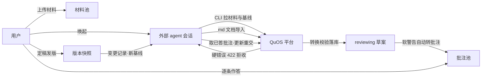
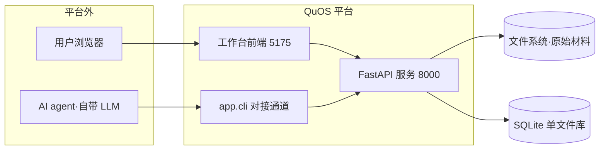

# QuOS 需求文档

| | |
|---|---|
| 版本 | v2.0.0 |
| 日期 | 2026-10-15 |
| 范围 | QuOS v2 平台自身（后端 + 工作台前端 + agent 对接通道）；v1 已整体废弃（ADR-003），不在本文范围 |
| 读者对象 | 开发 / 测试 / 未来协作者（单人使用，架构不设单人限制） |

## 1. 背景与目标

AI 写需求文档的问题不是写不出来，而是**没法信**：出处可以编、归属可以猜、边界可以糊。v1 用「平台内置 LLM 编排」把加工和把关攥在自己手里，结果是编排本身成了最大的不可信件。v2 反过来：**AI 加工完全外部化，平台只做三件事——给 agent 定标准、给人做闸门、给文档管生命周期。**

平台只做三件事：

1. **给 agent 定标准**——统一接口 + 两级校验，不合格的产出拒收；
2. **给人做闸门**——批注式评审（最小决策单元作答、定稿拍板、抽查）；
3. **给文档管生命周期**——版本快照 + 条款级变更记录 + 回退。

成功标准（可判定）：

- 规则 quote 无法在材料原文定位的草案，永远进不了库；
- 每个定稿版本可独立完整查看，任何条款的来龙去脉（谁改的、为什么、谁批的）可追溯；
- agent 从唤起到退出不需要人当传话筒——拉材料、交草案、取答案全部走接口/CLI。

明确不做：平台不内置任何 LLM 调用；不做多人协作与权限；不管文档以外的资产。

## 2. 用户与场景

### 用户类

| 用户类 | 特征 | 使用频率 | 能干什么 |
|---|---|---|---|
| 需求负责人（人） | 单人，平台所有者 | 每日 | 上传材料、评审批注、定稿/回退、抽查、管理项目 |
| 外部 AI agent | 在用户自己的 agent 会话中运行，无平台账号概念 | 按需唤起 | 拉材料/基线、提交草案、提批注、取已答批注（无定稿权） |

### 场景 1：冷启动出一个 v1.0（需求负责人 + agent）

用户建项目「云风控」，上传提测邮件与原型文档。在 agent 会话里说「整理这个项目的需求」。agent 经 CLI 拉材料清单和基线——基线返回 empty，走冷启动。agent 按 req-organize 全流程产 markdown 需求文档（含待确认问题清单），CLI 提交导入；平台转换、校验、把待确认问题转成批注锚到正文。用户打开评审页，右栏 18 条批注折叠着，逐条作答（有的选方案、有的确认理解、有的填空）。agent 下次唤起取走已答批注，更新文档重新提交。批注清零后用户点「定稿发版」，自定义版本号 v1.0.0。全部规则记为新增，版本快照落库，基线指向 v1.0.0。

异常分支：agent 提交的文档里有 ASCII 盒子图——平台 422 拒收并指出位置，agent 改成 mermaid 重导，全程无人工。

### 场景 2：迭代新素材（增量加工）

两周后用户上传新增的验收标准材料，唤起 agent。agent 拉到 v1.0.0 基线做增量加工：新需求成新规则、与基线冲突的每条显式作废并指向替代编号。重新提交后用户评审，定稿 v1.1.0——变更记录自动比对生成：每条新增/修改/作废的编号、旧文、新文、原因（优先取批注里人的回答）、批准人。

### 场景 3：回退走错的方向

v1.2 走偏了。用户在版本页对 v1.1.0 点「回退到此版」——基线指回 v1.1.0，v1.2 保留在历史可查，后续草案基于 v1.1.0 加工。评审页没有「打回」按钮：不满意的草案就是不定稿，让 agent 继续收敛或新草案覆盖。

## 3. 系统总览

一句话：QuOS 是一个**被动服务的需求文档质量工作台**——外部 agent 加工、平台校验拒收、人裁决定稿、版本留痕。

主链路：

上下文（系统边界）：

数据流向：材料原文只进不出文件系统；库是唯一真相源；agent 拿到的一切（材料文本、基线、答案）都来自接口，不读文件系统。

## 4. 需求主体

### 4.1 项目与材料（AI 加工的原料与容器）

为什么存在：一切加工从可信原料开始。材料是出处的唯一来源，项目把材料、文档、批注、版本圈在同一个语境里。

项目生命周期：创建（名称必填）、改名、描述编辑、归档（从默认列表隐藏，可恢复，数据完整）。项目列表每行可见：材料数、待答批注数、当前版本号、是否存在 reviewing 草案。

材料规则：

- FR-101 平台必须接受文档（pdf/docx/txt/md）与图片（png/jpg）上传，尽力抽取全文文本入 parsed_text（图片允许为空），原始二进制落文件系统并记录 sha256 与路径。
- FR-102 材料只增不改：不提供编辑与覆盖；同 sha256 重复上传必须提示已存在并指向原记录，不产生重复条目。
- FR-103 材料清单接口必须返回全部材料的解析文本，作为 agent 出处核对与 quote 复制的唯一来源。
- FR-104 被 active 规则引用出处的材料不可删除，拒删响应必须指明引用它的规则编号清单。

异常路径：文本解析失败保留原件可重试（parsed_text 空，不报错）；图片类材料 quote 校验豁免。

### 4.2 文档加工与两级校验（给 agent 定标准）

为什么存在：这是「给 agent 定标准」的落点。校验两级分流——硬错误是机器能判定的失信（出处定位不到、编号冲突、结构断链），拒收；软警告是机器存疑该人裁的，转题目进闸门，不阻塞。

文档形态契约：主产物是章节式需求文档（给人读），规则条目库是锚点层（给机器引用）。

- FR-201 章节正文必须由有序自由块组成，块类型限六类：para（叙述）/ states（状态链）/ table（表格）/ figure（链路图）/ exceptions（异常路径）/ diagram（mermaid 源码，统一图渲染）；无固定槽位，内容决定结构。
- FR-202 章节可经 parent 指向父章节构成层级；渲染自动编号（1 / 1.1）。
- FR-203 表格与主链路必须以块承载，不得拆散塞进规则 text（同批内容两处维护必漂移）。

提交与硬校验（POST /doc/draft 与 /doc/draft/import 同闸门）：

- FR-204 active 规则的 quote 必须在所指材料 parsed_text 中可定位（归一化子串匹配）；定位失败必须整体拒收并在错误明细附材料内最相近片段；quote 少于 6 字符降级软警告；图片类材料豁免。
- FR-205 规则编号草案内部唯一；复用库中现存同编号视为修改路径放行；引用编号必须闭合；material_id 必须存在。
- FR-206 规则作废必须显式 status="voided" 且带 replaced_by 指向替代编号；复活已作废编号被拒；不物理删除。
- FR-207 正文块结构非法（空表格、未知块型）、parent 断链或成环，必须整体拒收并返回 BLOCK_*/CHAPTER_PARENT_* 明细。
- FR-208 任一硬错误时整份草案不入库。

markdown 导入（agent 的推荐提交路径）：

- FR-209 平台必须内置 md→DocPayload 转换（章节层级/规则编号/正文块/表格/术语表/图），agent 只产 markdown 文档，可选 rules_meta 精修 violation 与 quote。
- FR-210 规则 quote 必须自动匹配项目材料文本（相似度达标挂出处），未匹配留空走软警告由人评审补。
- FR-211 格式契约违规必须导入即拒收：ASCII 盒子图、mermaid 节点半角括号、引用块承载实质内容、mermaid 语法错误（node 端真实 parse），422 附位置与修法——导入即验证，agent 自动修复重导，全程无人工。
- FR-212 附录待确认问题清单必须自动转为 agent 批注并三级锚定正文：题面有规则号锚到该规则；正文有【TBD-xx】标注锚到该章；均无锚到章兜底。

覆盖与批注联动：

- FR-213 新草案落库时旧 reviewing 草案置 superseded，其 pending 批注撤回、answered 存续；此前被撤回的同内容 agent 批注重导时复活为 pending（重导意味着问题仍有效，不得被去重吞掉）。
- FR-214 软警告不阻塞入库，自动转批注：申报新术语→术语确认题、术语正文写法不一致→确认题、violation 与正文雷同→确认题、空壳章节（无正文块且零规则且无子章）→填空题；自动题按题型与关键内容去重。
- FR-215 提交响应必须携带完整校验报告（hard_errors / soft_warnings / 自动题目清单），供 agent 决定修正重交或留给人裁。

### 4.3 批注式评审（给人做闸门）

为什么存在：「答题卡」式评审没人做得完。批注把每个待决问题钉在它发生的正文位置上，人的最小决策单元是一次点击或一行填空。

- FR-216 全部待确认问题必须以批注形式锚定正文：规则句级（边界未定义/材料冲突/可判定存疑/实证核对）、术语批注（锚首次出现处）、章节级（空壳章锚标题旁）；题型限四种 choice / confirm / fill / scan。
- FR-217 评审页为固定视口结构（各栏独立滚动）：文档区 = 正文（恒全宽，块按六类分派渲染）+ 内嵌目录列（章节树层级编号与每章批注计数；常驻/悬浮/隐藏三态，右缘拖拽调宽并记忆）；术语表以文档末章词条表呈现，点击词条定位正文出现章节；右为批注栏。
- FR-218 批注卡默认折叠（只显摘要一行+编号·类型元信息），点击展开上下文与作答选项；每张未答卡带定位按钮（滚动正文至锚点并高亮）；作答后卡片收起转绿、正文标记同步转绿；已答可重新作答。
- FR-219 支持对照（三栏同屏）与逐条（单卡聚焦+进度+上/下条推进+正文自动定位）两种评审模式。
- FR-220 正文批注标记未答琥珀、已答绿；点击规则编号弹出 popover 展示可判定表述（怎样算违反）与出处引用（材料与 hash）。
- FR-221 批注作答接口对 pending/answered 均可作答（重复作答=覆盖，批量扫逐项提交依赖此语义）；已撤回批注作答被拒。
- FR-222 已答批注必须可经接口按 status=answered 取回（题型、题干、答案、锚点、作答时间），支撑 agent 下次唤起续跑。

### 4.4 定稿与版本（给文档管生命周期）

为什么存在：需求文档的价值在时间轴上——每一版谁改了什么、为什么、谁批的。版本平台自管，不依赖 git。

- FR-223 定稿发版仅人在评审页执行；版本号由人自定义输入（平台给建议值），与历史重复必须拦截；发版说明选填。
- FR-224 agent 无发版权，只能反馈建议。
- FR-225 定稿时必须与上一版逐规则比对自动生成变更记录：新增/修改/作废（作废以草案显式声明为准，不靠规则消失推断），含编号、旧文、新文、原因（优先取对应批注的人答）、批准人。
- FR-226 规则编号项目内跨版本稳定：内容小改编号不变；作废留痕不删除。
- FR-227 定稿由快照术语表全量重建术语表（表=当前态，快照=历史）。
- FR-228 版本页呈现时间线（评审中草案+历史定稿）与选中版本的条款级 diff；任意历史版本可完整查看（快照自包含）。
- FR-229 任一已定稿版本可「回退到此版」：设为当前基线，后续版本保留不删；评审页不提供打回——草案不满意即不定稿。
- FR-230 无定稿项目基线接口返回 empty 标志（agent 冷启动判据）。

### 4.5 agent 对接通道（接口与 CLI）

为什么存在：agent 短事务（唤起→拉取→加工→提交→退出）需要稳定、可机器读的对接面；curl 手拼大 body 易错，422 明细难读。

- FR-231 agent 对接的全部端点必须提供 CLI 等价命令（`uv run --directory server python -m app.cli <cmd>`，10 个子命令：projects / materials / baseline / draft / import-draft / submit-draft / questions / post-questions / versions / changes），服务端行为与 HTTP 调用完全一致。
- FR-232 CLI 大内容（md 全文、payload、批注数组）必须文件传参，不经 shell 转义。
- FR-233 CLI 输出约定：成功响应 JSON 出 stdout 退出码 0；HTTP 错误响应体（含 hard_errors）仍完整出 stdout、退出码 1；连接失败/网络异常/输入文件不可用退出码 2 且 stderr 人话提示，不抛 traceback。
- FR-234 接口契约以 `docs/api.md` 为权威参考；调用协议与纪律（顺序、校验报告处理）以 `docs/quos-agent-api.md` 为准。
- FR-235 接口与 CLI 的变更必须按仓库根 `AGENTS.md` 同步维护规则执行（api.md / cli.py / 协议文档 / skill 指引），agent 是文档的第一维护人。

### 4.6 工作台骨架

为什么存在：批注评审的效率全在布局——三栏同屏、独立滚动、定位不迷路。

- FR-236 深色侧栏 + 浅色内容区骨架；侧栏为项目树，进入项目展开项目内子页（材料 / 文档评审 / 版本），材料与评审是项目内资源不做全局一级页；面包屑 QuOS / 项目名 / 子页。
- FR-237 文档评审入口带待处理批注数徽标。
- FR-238 评审页工具条含草案状态徽标（草案评审中/当前基线）、基于基线版本与变更摘要文字、定稿发版按钮。

## 5. 非功能需求

- NFR-01 单机本地运行：localhost、接口无鉴权（单人使用，架构不设单人限制）。
- NFR-02 存储唯一真相源为 SQLite 单文件库；原始二进制材料存文件系统，库内只存路径与 hash。
- NFR-03 平台进程零 LLM 调用：AI 加工全部发生在平台边界之外。
- NFR-04 mermaid 语法校验复用前端已装依赖（node 端真实 parse），不新增包。
- NFR-05 CLI 零新增依赖（argparse + httpx）；对本机系统代理免疫（trust_env=false）。
- NFR-06 后端测试基线 91 全绿（含 CLI 13 用例）；校验口径变更必须随测试更新。

## 6. 约束、假设与开放问题

外部依赖（挂了会怎样）：

| 依赖 | 用途 | 挂了的影响 |
|---|---|---|
| node | mermaid 语法真实校验 | 校验器降级为放行（不阻塞导入），语法错误漏到前端渲染兜底 |
| 前端构建链 | 工作台静态资源 | 接口仍可用，页面打不开 |
| 用户的 agent 会话（自带 LLM） | 一切加工 | 平台只能查看与评审存量，无新草案产生 |

假设：材料文本是出处的可信来源（平台不质疑材料本身真伪）；单人使用期间无并发提交草案（撞 reviewing 唯一约束返回 409）。

开放问题：

- **TBD-01** 评审门目前是 skill 纪律非平台机制：draft 提交是否强制附 review 报告（无报告 422 拒收）——待拍板。
- **TBD-02** 仓库转公开前需清理 git 历史中的凭证。
- **TBD-03** 平台侧触发 agent（定时任务、webhook）属远期演进，当前触发权完全在 agent 侧。

## 7. 术语表

| 术语 | 含义 |
|---|---|
| 材料 / parsed_text | 用户上传的原始文件 / 平台抽取的全文文本，出处核对的唯一来源 |
| 草案（reviewing） | agent 提交、待评审的文档版本，被新草案覆盖后置 superseded |
| 基线 | 当前定稿版本，agent 增量加工的起点 |
| 批注 | 锚定在正文上的待决问题，四种题型；来源分 agent（含导入转题）与 auto（软警告转题） |
| 规则 | 行为级约束条目，编号全局稳定；violation=怎样算违反，quote=材料原文出处切片 |
| 两级校验 | 硬错误拒收（机器判定的失信）/ 软警告转题（机器存疑人裁） |
| 覆盖语义 | 新草案落库→旧草案 superseded→其 pending 批注撤回、answered 存续 |
| 复活语义 | 重导草案时，此前被撤回的同内容 agent 批注置回 pending |
| 空壳章节 | 无正文块、零规则且无子章的章节，软警告出填空题 |
| hard_errors | 422 拒收响应中的错误明细数组，每项含 code / rule_no / detail |

## 8. 变更记录

| 版本 | 日期 | 变更 | 批准 |
|---|---|---|---|
| v2.0.0 | 2026-10-15 | 初版：v1 整体废弃（ADR-003），按 openspec/specs 七能力域现状重组为 v2 需求基线 | 需求负责人 |
